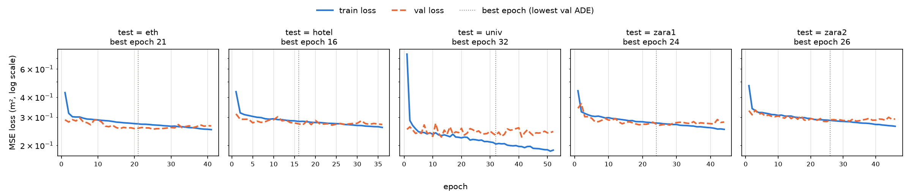

# trajectory-prediction

ETH/UCY 보행자 궤적 데이터로 **등속 · LSTM · Transformer** 예측 모델을 비교하고, 이후 Argoverse 2 차량 데이터로 넓히는 공부용 저장소다.

| 단계 | 내용 | 상태 |
| :-: | :--- | :--- |
| 1 | 환경, 데이터 파이프라인, ADE/FDE, 등속 모델 기준선 | 완료 |
| 2 | Vanilla LSTM encoder-decoder | 완료 |
| 3 | Transformer | 예정 |
| 4 | Argoverse 2 차량 데이터로 확장 | 예정 |

문제 설정은 관련 연구의 표준을 따른다. **과거 8스텝(3.2 s)을 보고 미래 12스텝(4.8 s)을 예측한다.** 한 스텝은 0.4 s이고 좌표 단위는 미터다.

## 환경

Ubuntu 24.04, Python 3.12, NVIDIA GeForce RTX 4070 Laptop GPU에서 확인했다.

```bash
python3 -m venv .venv
.venv/bin/pip install -r requirements.txt   # PyTorch 2.11.0 (CUDA 12.8 빌드)
.venv/bin/pip install -e .                  # src/trajpred 패키지
.venv/bin/python scripts/check_gpu.py
```

이 PC에서 실행한 결과는 다음과 같다.

```
torch        : 2.11.0+cu128
built w/ CUDA: 12.8
cuda available: True
GPU          : NVIDIA GeForce RTX 4070 Laptop GPU
```

## 데이터

### 출처와 라이선스

| 항목 | 내용 |
| :--- | :--- |
| 원본 데이터 | ETH (BIWI Walking Pedestrians): Pellegrini et al., *You'll never walk alone: Modeling social behavior for multi-target tracking*, ICCV 2009. 장면 `eth`, `hotel` |
| | UCY (Crowds by Example): Lerner et al., *Crowds by Example*, Computer Graphics Forum 2007. 장면 `univ`, `zara1`, `zara2` |
| 전처리 · 분할 | Social-GAN (Gupta et al., *Social GAN*, CVPR 2018)이 배포한 leave-one-out 분할. 이후 많은 논문이 같은 파일을 쓴다 |
| 받는 곳 | [Trajectron++ 저장소](https://github.com/StanfordASL/Trajectron-plus-plus/tree/1031c7bd1a444273af378c1ec1dcca907ba59830/experiments/pedestrians/raw)의 `experiments/pedestrians/raw` (저장소 라이선스 MIT), 커밋 `1031c7b`에 고정 |

- `scripts/download_data.sh`가 받는 파일 74개는 Social-GAN의 `datasets.zip`([sgan/scripts/download_data.sh](https://github.com/agrimgupta92/sgan/blob/master/scripts/download_data.sh))과 **바이트 단위로 같다**. 두 곳에서 모두 받아 `diff`로 확인했다. Dropbox 링크보다 오래 유지될 GitHub 쪽을 쓴다.
- 원본 ETH/UCY 데이터의 이용 조건은 원 저작자에게 있다. 이 저장소는 데이터를 **재배포하지 않는다**. `data/raw/`는 `.gitignore`에 들어 있다.

```bash
bash scripts/download_data.sh    # -> data/raw/<scene>/{train,val,test}/*.txt
```

### 파일 형식과 분할

한 줄은 한 보행자의 한 프레임이다. 탭으로 구분한 `frame_id  ped_id  x  y`이고, 좌표는 미터다.

leave-one-out 분할은 폴더 구조에 이미 들어 있다.

| 폴더 | 내용 |
| :--- | :--- |
| `data/raw/<scene>/train`, `val` | `<scene>`을 뺀 나머지 4개 장면의 학습 · 검증 구간 |
| `data/raw/<scene>/test` | `<scene>` 장면 전체. 평가에 쓴다 |

### 데이터셋 클래스 (`src/trajpred/data.py`)

```python
from trajpred.data import load_split
ds = load_split('data/raw', 'zara1', 'test', normalize=True)
obs, fut, origin = ds[0]   # [8, 2], [12, 2], [2]
```

- 연속한 20프레임을 한 칸씩 밀며 자르고, 20프레임에 모두 등장한 보행자만 샘플로 쓴다. 이런 보행자가 2명 이상인 윈도우만 남긴다. 이 규칙은 Social-GAN 데이터 로더(`sgan/data/trajectories.py`)와 같다.
- `normalize=True`이면 마지막 관측점을 원점으로 하는 상대 좌표로 바꾼다. 원래 위치는 `origin`에 남는다.
- **Social-GAN 로더와의 일치 확인**: Social-GAN의 `TrajectoryDataset`을 같은 파일에 직접 돌려 비교했다. 5개 장면의 train · test 분할 모두에서 샘플 수가 같고, 샘플 좌표도 같다. 순서만 다를 수 있다. Social-GAN은 `os.listdir` 순서로, 이 저장소는 파일 이름순으로 읽는다.

| 장면 | train 샘플 | test 샘플 |
| :--- | --: | --: |
| eth | 29,809 | 181 |
| hotel | 29,152 | 1,053 |
| univ | 9,231 | 24,334 |
| zara1 | 28,010 | 2,253 |
| zara2 | 25,507 | 5,833 |

## 평가 지표 (`src/trajpred/metrics.py`)

- **ADE**: 예측 12스텝 각각에서 예측점과 실제점 사이 거리(m)의 평균
- **FDE**: 마지막 스텝에서의 거리(m)

장면 값은 그 장면 모든 샘플의 평균이고, AVG는 5개 장면 값의 단순 평균이다.

## 결과: 등속 모델

마지막 두 관측점의 차이를 한 스텝 속도로 보고, 그대로 12스텝을 이어 간다(`src/trajpred/models/constant_velocity.py`).

```bash
.venv/bin/python scripts/eval_cv.py   # -> results/cv.csv, results/cv_examples.png
```

아래는 이 저장소에서 실행한 값이다. 예측은 결정적이라 실행할 때마다 같다.

| 장면 | test 샘플 | ADE (m) | FDE (m) |
| :--- | --: | --: | --: |
| eth | 181 | 0.995 | 2.234 |
| hotel | 1,053 | 0.323 | 0.617 |
| univ | 24,334 | 0.524 | 1.165 |
| zara1 | 2,253 | 0.431 | 0.960 |
| zara2 | 5,833 | 0.326 | 0.728 |
| **AVG** | | **0.520** | **1.141** |


- 위 줄은 움직이는 보행자(관측 평균 속도 0.5 m/s 이상) 가운데 FDE가 중앙값에 가장 가까운 전형적인 예다.
- 아래 줄은 장면마다 FDE가 가장 큰 예다. 관측 구간에서는 직진하다가 예측 구간에서 크게 꺾는 경우인데, 등속 모델은 이런 방향 전환을 원리상 맞힐 수 없다.

### 논문 수치와 비교

[Schöller et al., *What the Constant Velocity Model Can Teach Us About Pedestrian Motion Prediction*, RA-L 2020](https://arxiv.org/abs/1903.07933)은 같은 등속 모델(마지막 두 스텝의 속도를 유지)을 ETH/UCY에서 평가했다. 아래는 그 논문 Table I의 `OUR` 열(ADE / FDE, m)이다.

| | eth | hotel | univ | zara1 | zara2 | AVG |
| :--- | :-: | :-: | :-: | :-: | :-: | :-: |
| Schöller et al. 2020, Table I | 0.58 / 1.15 | 0.27 / 0.51 | 0.46 / 1.02 | 0.34 / 0.76 | 0.31 / 0.69 | 0.39 / 0.83 |
| 이 저장소 | 0.995 / 2.234 | 0.323 / 0.617 | 0.524 / 1.165 | 0.431 / 0.960 | 0.326 / 0.728 | 0.520 / 1.141 |

**속도 계산 방식은 같다.** 논문 PDF(arXiv 1903.07933) IV절에서 직접 확인했다.

| | 속도 | 예측 |
| :--- | :--- | :--- |
| Schöller et al. 2020, 식 (3) | $\Delta_i = p_i^t - p_i^{t-1}$ ("observed from the latest two timesteps") | 변위 $(\Delta_i, \dots, \Delta_i)$를 12번 이어 붙인다 |
| 이 저장소 (`constant_velocity.py`) | `v = obs[-1] - obs[-2]` | `pred[k] = obs[-1] + (k+1) * v` |

두 식은 같은 예측을 낸다(변위를 누적하면 $p^t + (k+1)\Delta$). 필터링이나 관측 구간 평균을 쓰지 않으므로 둘 다 측정 잡음에 민감하다고 논문도 적었다. 따라서 아래 수치 차이는 속도 계산이 아니라 다른 데서 온다.

모든 장면에서 이 저장소의 값이 더 크고, eth에서 차이가 가장 크다. 확인한 차이는 두 가지다.

1. **평가 샘플 규칙이 다르다.** 그 논문은 "길이가 10보다 짧은 잘린 궤적을 버린다(we reject sliced trajectories with a length shorter than 10)"고 적었다. 즉 미래가 12스텝보다 짧은 궤적도 평가에 들어간다. 이 저장소는 Social-GAN 규칙대로 20스텝이 다 있는 궤적만 쓴다. 예측 거리가 짧은 샘플이 섞이면 평균 오차는 작아진다.
2. **eth 장면의 보행 속도가 유난히 크다.** 이 파일에서 보행자가 한 스텝(0.4 s)에 움직이는 평균 거리는 eth 0.95 m(약 2.4 m/s)이고, hotel 0.46 m, zara1 0.46 m, univ(students001) 0.29 m다. 등속 모델의 오차는 속도에 비례해 커지므로 eth 값이 크게 나온다. 같은 파일을 쓴 그 논문의 eth 값이 왜 이보다 작은지는 데이터 처리 방식을 알 수 없어 확인하지 못했다.

## 결과: Vanilla LSTM encoder-decoder

주변 보행자를 보지 않는 단일 보행자 모델이다(`src/trajpred/models/lstm.py`).

- **입출력**: 위치 대신 한 스텝 변위 `obs[t] - obs[t-1]`을 쓴다. 관측 8점에서 변위 7개가 나온다.
- **인코더**: 변위 → `Linear(2, 64) + ReLU` → `LSTM(64, 128)`. 마지막 상태 `(h, c)`를 디코더에 넘긴다.
- **디코더(autoregressive)**: `LSTMCell(64, 128)`을 12번 돌린다. 스텝마다 `Linear(128, 2)`로 다음 변위를 내고, 그 **자기 예측**을 다음 스텝 입력으로 넣는다. 첫 입력은 마지막 관측 변위다. 학습 때도 정답을 넣지 않는다(teacher forcing 없음).
- **위치**: 마지막 관측점 + 예측 변위의 누적합.
- **학습**: 손실은 예측 위치의 MSE. Adam(lr 1e-3), 배치 64, 기울기 노름 1.0으로 자르기, 시드 0. 데이터 증강(회전 등)은 쓰지 않았다.
- **검증 · early stopping**: `data/raw/<scene>/val`(test 장면을 뺀 4개 장면의 검증 구간)에서 에폭마다 ADE를 잰다. 20 에폭 동안 좋아지지 않으면 멈추고, val ADE가 가장 낮았던 모델을 `checkpoints/lstm_<scene>.pt`에 저장한다. test 분할은 학습과 모델 선택에 쓰지 않고, 저장한 best 모델로 마지막에 한 번만 평가한다.

```bash
.venv/bin/python scripts/train_lstm.py   # -> results/lstm.csv, lstm_history.csv, lstm_curves.png, checkpoints/
```

RTX 4070 Laptop에서 에폭당 약 2.5 s, 5개 분할 전체가 약 7분 걸렸다. 아래는 그 한 번(시드 0)의 실행값이다. GPU 연산의 비결정성 때문에 다시 돌리면 소수 셋째 자리가 조금 달라질 수 있다. 시드를 바꾼 반복 실험은 하지 않았다.

| 장면 | test 샘플 | best epoch | 등속 ADE | 등속 FDE | LSTM ADE | LSTM FDE |
| :--- | --: | --: | --: | --: | --: | --: |
| eth | 181 | 21 | 0.995 | 2.234 | **0.933** | **1.936** |
| hotel | 1,053 | 16 | **0.323** | **0.617** | 0.566 | 1.166 |
| univ | 24,334 | 32 | **0.524** | 1.165 | 0.537 | **1.164** |
| zara1 | 2,253 | 24 | **0.431** | **0.960** | 0.440 | 0.962 |
| zara2 | 5,833 | 26 | **0.326** | 0.729 | 0.336 | 0.729 |
| **AVG** | | | **0.520** | **1.141** | 0.562 | 1.192 |

(단위 m, 굵은 글씨는 장면별로 더 작은 값)



- **평균으로는 LSTM이 등속 모델보다 나쁘다.** eth에서만 확실히 낫고, univ · zara1 · zara2는 거의 같으며, hotel에서 크게 진다. Schöller et al.이 지적한 "단순 등속 모델이 학습형 모델과 맞먹는다"는 현상이 이 실험에서도 나타난다.
- **학습 곡선**: 다섯 분할 모두 val loss가 10~30 에폭 근처에서 평평해지고, 그 뒤로는 train loss만 내려간다(과적합 시작). univ 분할(학습 샘플 9,231개로 가장 적다)에서 train과 val의 간격이 가장 크다.

### hotel에서 LSTM이 지는 이유: 진행 방향 편향

`scripts/diag_lstm_direction.py`로 확인했다.

1. **진행 방향 분포가 다르다.** 20스텝 동안 1 m 이상 움직인 보행자 가운데 x 방향 이동이 더 큰 비율은 hotel 분할의 train(나머지 4개 장면)에서 76%(22,859명 중), hotel test에서 6%(444명 중)다. hotel 보행자는 대부분 y 방향으로 걷는데, 학습 데이터에는 x 방향이 많다.
2. **입력을 돌리면 오차가 줄어든다.** 학습한 hotel 모델에 test 입력을 90° 단위로 돌려 넣고 예측을 되돌리면 ADE가 0° 0.566, 90° 0.367, 180° 0.584, 270° 0.370이다. 학습 때 많이 본 방향(x)으로 돌려 주면 오차가 크게 준다. 즉 모델이 좌표축 방향에 맞춰져 있다. 비교로 eth(test의 98%가 x 방향)는 돌리지 않은 0°가 0.933으로 가장 좋다.

등속 모델은 회전과 무관해서 이 문제가 없다. 학습 때 궤적을 무작위로 회전하는 증강을 넣으면 줄어들 것으로 예상하지만 아직 실험하지 않았다. 위 회전 시험은 원인 확인용이고, 표의 LSTM 수치에는 쓰지 않았다.

## 코드 구조

```
scripts/
  download_data.sh     데이터 받기 (커밋 고정)
  check_gpu.py         CUDA 확인
  eval_cv.py           등속 모델 평가, 표 · 그림 저장
  train_lstm.py        LSTM 학습 (leave-one-out 5개), early stopping, test 평가, 표 · 학습 곡선 저장
  diag_lstm_direction.py  LSTM 진행 방향 편향 진단 (hotel)
src/trajpred/
  data.py              파일 읽기, 8 -> 12 윈도우 데이터셋, leave-one-out 분할
  metrics.py           ADE, FDE
  models/
    constant_velocity.py
    lstm.py            Vanilla LSTM encoder-decoder (autoregressive)
results/
  cv.csv, cv_examples.png
  lstm.csv, lstm_history.csv, lstm_curves.png
checkpoints/           best 모델 (git 에 넣지 않는다)
```
