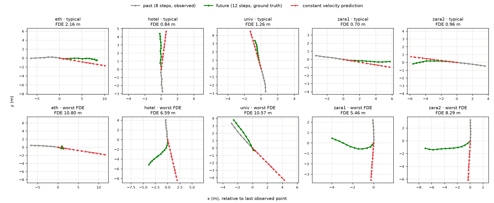
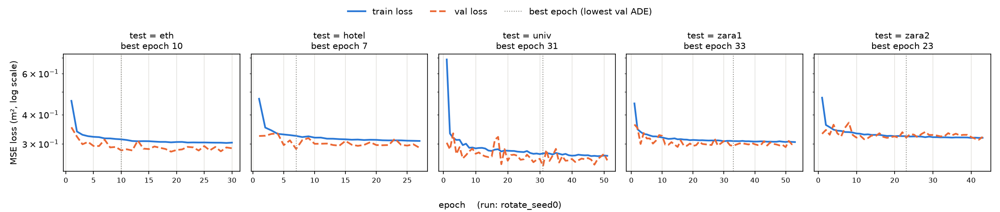

# trajectory-prediction

ETH/UCY 보행자 궤적 데이터로 **등속 · LSTM · Transformer** 예측 모델을 비교하고, 이후 Argoverse 2 차량 데이터로 넓히는 공부용 저장소다.

| 단계 | 내용 | 상태 |
| :-: | :--- | :--- |
| 1 | 환경, 데이터 파이프라인, ADE/FDE, 등속 모델 기준선 | 완료 |
| 2 | Vanilla LSTM encoder-decoder, 회전 증강 | 완료 |
| A | 오차 분석: 오차 분해, heading 정규화, residual ([분석](docs/analysis.md), [노트](docs/notes/A_analysis.md)) | 완료 |
| B | 상호작용: 같은 프레임 이웃의 grid pooling ([분석](docs/interaction.md), [노트](docs/notes/B_interaction.md)) | 완료 |
| C | Transformer: 시간축 + 보행자 간 attention | 예정 |
| D | Multimodal: K=20 예측, best-of-20 | 예정 |
| E | Argoverse 2로 차량 확장 | 예정 |

단계별 목표와 완료 기준은 [docs/ROADMAP.md](docs/ROADMAP.md)에 있다.

문제 설정은 관련 연구의 표준을 따른다. **과거 8스텝(3.2 s)을 보고 미래 12스텝(4.8 s)을 예측한다.** 한 스텝은 0.4 s이고 좌표 단위는 미터다.

## 환경

Ubuntu 24.04, Python 3.12, NVIDIA GeForce RTX 4070 Laptop GPU에서 확인했다.

```bash
python3 -m venv .venv
.venv/bin/pip install -r requirements.txt   # PyTorch 2.11.0 (CUDA 12.8 빌드)
.venv/bin/pip install -e .                  # src/trajpred 패키지
.venv/bin/python scripts/check_gpu.py
```

이 PC에서 실행한 결과는 다음과 같다.

```
torch        : 2.11.0+cu128
built w/ CUDA: 12.8
cuda available: True
GPU          : NVIDIA GeForce RTX 4070 Laptop GPU
```

## 데이터

### 출처와 라이선스

| 항목 | 내용 |
| :--- | :--- |
| 원본 데이터 | ETH (BIWI Walking Pedestrians): Pellegrini et al., *You'll never walk alone: Modeling social behavior for multi-target tracking*, ICCV 2009. 장면 `eth`, `hotel` |
| | UCY (Crowds by Example): Lerner et al., *Crowds by Example*, Computer Graphics Forum 2007. 장면 `univ`, `zara1`, `zara2` |
| 전처리 · 분할 | Social-GAN (Gupta et al., *Social GAN*, CVPR 2018)이 배포한 leave-one-out 분할. 이후 많은 논문이 같은 파일을 쓴다 |
| 받는 곳 | [Trajectron++ 저장소](https://github.com/StanfordASL/Trajectron-plus-plus/tree/1031c7bd1a444273af378c1ec1dcca907ba59830/experiments/pedestrians/raw)의 `experiments/pedestrians/raw` (저장소 라이선스 MIT), 커밋 `1031c7b`에 고정 |

- `scripts/download_data.sh`가 받는 파일 74개는 Social-GAN의 `datasets.zip`([sgan/scripts/download_data.sh](https://github.com/agrimgupta92/sgan/blob/master/scripts/download_data.sh))과 **바이트 단위로 같다**. 두 곳에서 모두 받아 `diff`로 확인했다. Dropbox 링크보다 오래 유지될 GitHub 쪽을 쓴다.
- 원본 ETH/UCY 데이터의 이용 조건은 원 저작자에게 있다. 이 저장소는 데이터를 **재배포하지 않는다**. `data/raw/`는 `.gitignore`에 들어 있다.

```bash
bash scripts/download_data.sh    # -> data/raw/<scene>/{train,val,test}/*.txt
```

### 파일 형식과 분할

한 줄은 한 보행자의 한 프레임이다. 탭으로 구분한 `frame_id  ped_id  x  y`이고, 좌표는 미터다.

leave-one-out 분할은 폴더 구조에 이미 들어 있다.

| 폴더 | 내용 |
| :--- | :--- |
| `data/raw/<scene>/train`, `val` | `<scene>`을 뺀 나머지 4개 장면의 학습 · 검증 구간 |
| `data/raw/<scene>/test` | `<scene>` 장면 전체. 평가에 쓴다 |

### 데이터셋 클래스 (`src/trajpred/data.py`)

```python
from trajpred.data import load_split
ds = load_split('data/raw', 'zara1', 'test', normalize=True)
obs, fut, origin = ds[0]   # [8, 2], [12, 2], [2]
```

- 연속한 20프레임을 한 칸씩 밀며 자르고, 20프레임에 모두 등장한 보행자만 샘플로 쓴다. 이런 보행자가 2명 이상인 윈도우만 남긴다. 이 규칙은 Social-GAN 데이터 로더(`sgan/data/trajectories.py`)와 같다.
- `normalize=True`이면 마지막 관측점을 원점으로 하는 상대 좌표로 바꾼다. 원래 위치는 `origin`에 남는다.
- **Social-GAN 로더와의 일치 확인**: Social-GAN의 `TrajectoryDataset`을 같은 파일에 직접 돌려 비교했다. 5개 장면의 train · test 분할 모두에서 샘플 수가 같고, 샘플 좌표도 같다. 순서만 다를 수 있다. Social-GAN은 `os.listdir` 순서로, 이 저장소는 파일 이름순으로 읽는다.

| 장면 | train 샘플 | test 샘플 |
| :--- | --: | --: |
| eth | 29,809 | 181 |
| hotel | 29,152 | 1,053 |
| univ | 9,231 | 24,334 |
| zara1 | 28,010 | 2,253 |
| zara2 | 25,507 | 5,833 |

## 평가 지표 (`src/trajpred/metrics.py`)

- **ADE**: 예측 12스텝 각각에서 예측점과 실제점 사이 거리(m)의 평균
- **FDE**: 마지막 스텝에서의 거리(m)

장면 값은 그 장면 모든 샘플의 평균이고, AVG는 5개 장면 값의 단순 평균이다.

## 결과: 등속 모델

마지막 두 관측점의 차이를 한 스텝 속도로 보고, 그대로 12스텝을 이어 간다(`src/trajpred/models/constant_velocity.py`).

```bash
.venv/bin/python scripts/eval_cv.py   # -> results/cv.csv, results/cv_examples.png
```

아래는 이 저장소에서 실행한 값이다. 예측은 결정적이라 실행할 때마다 같다.

| 장면 | test 샘플 | ADE (m) | FDE (m) |
| :--- | --: | --: | --: |
| eth | 181 | 0.995 | 2.234 |
| hotel | 1,053 | 0.323 | 0.617 |
| univ | 24,334 | 0.524 | 1.165 |
| zara1 | 2,253 | 0.431 | 0.960 |
| zara2 | 5,833 | 0.326 | 0.728 |
| **AVG** | | **0.520** | **1.141** |



- 위 줄은 움직이는 보행자(관측 평균 속도 0.5 m/s 이상) 가운데 FDE가 중앙값에 가장 가까운 전형적인 예다.
- 아래 줄은 장면마다 FDE가 가장 큰 예다. 관측 구간에서는 직진하다가 예측 구간에서 크게 꺾는 경우인데, 등속 모델은 이런 방향 전환을 원리상 맞힐 수 없다.

### 논문 수치와 비교

[Schöller et al., *What the Constant Velocity Model Can Teach Us About Pedestrian Motion Prediction*, RA-L 2020](https://arxiv.org/abs/1903.07933)은 같은 등속 모델(마지막 두 스텝의 속도를 유지)을 ETH/UCY에서 평가했다. 아래는 그 논문 Table I의 `OUR` 열(ADE / FDE, m)이다.

| | eth | hotel | univ | zara1 | zara2 | AVG |
| :--- | :-: | :-: | :-: | :-: | :-: | :-: |
| Schöller et al. 2020, Table I | 0.58 / 1.15 | 0.27 / 0.51 | 0.46 / 1.02 | 0.34 / 0.76 | 0.31 / 0.69 | 0.39 / 0.83 |
| 이 저장소 | 0.995 / 2.234 | 0.323 / 0.617 | 0.524 / 1.165 | 0.431 / 0.960 | 0.326 / 0.728 | 0.520 / 1.141 |

**속도 계산 방식은 같다.** 논문 PDF(arXiv 1903.07933) IV절에서 직접 확인했다.

| | 속도 | 예측 |
| :--- | :--- | :--- |
| Schöller et al. 2020, 식 (3) | $\Delta_i = p_i^t - p_i^{t-1}$ ("observed from the latest two timesteps") | 변위 $(\Delta_i, \dots, \Delta_i)$를 12번 이어 붙인다 |
| 이 저장소 (`constant_velocity.py`) | `v = obs[-1] - obs[-2]` | `pred[k] = obs[-1] + (k+1) * v` |

두 식은 같은 예측을 낸다(변위를 누적하면 $p^t + (k+1)\Delta$). 필터링이나 관측 구간 평균을 쓰지 않으므로 둘 다 측정 잡음에 민감하다고 논문도 적었다. 따라서 아래 수치 차이는 속도 계산이 아니라 다른 데서 온다.

모든 장면에서 이 저장소의 값이 더 크고, eth에서 차이가 가장 크다. 확인한 차이는 두 가지다.

1. **평가 샘플 규칙이 다르다.** 그 논문은 "길이가 10보다 짧은 잘린 궤적을 버린다(we reject sliced trajectories with a length shorter than 10)"고 적었다. 즉 미래가 12스텝보다 짧은 궤적도 평가에 들어간다. 이 저장소는 Social-GAN 규칙대로 20스텝이 다 있는 궤적만 쓴다. 예측 거리가 짧은 샘플이 섞이면 평균 오차는 작아진다.
2. **eth 장면의 보행 속도가 유난히 크다.** 이 파일에서 보행자가 한 스텝(0.4 s)에 움직이는 평균 거리는 eth 0.95 m(약 2.4 m/s)이고, hotel 0.46 m, zara1 0.46 m, univ(students001) 0.29 m다. 등속 모델의 오차는 속도에 비례해 커지므로 eth 값이 크게 나온다. 같은 파일을 쓴 그 논문의 eth 값이 왜 이보다 작은지는 데이터 처리 방식을 알 수 없어 확인하지 못했다.

## 결과: Vanilla LSTM encoder-decoder

주변 보행자를 보지 않는 단일 보행자 모델이다(`src/trajpred/models/lstm.py`).

- **입출력**: 위치 대신 한 스텝 변위 `obs[t] - obs[t-1]`을 쓴다. 관측 8점에서 변위 7개가 나온다.
- **인코더**: 변위 → `Linear(2, 64) + ReLU` → `LSTM(64, 128)`. 마지막 상태 `(h, c)`를 디코더에 넘긴다.
- **디코더(autoregressive)**: `LSTMCell(64, 128)`을 12번 돌린다. 스텝마다 `Linear(128, 2)`로 다음 변위를 내고, 그 **자기 예측**을 다음 스텝 입력으로 넣는다. 첫 입력은 마지막 관측 변위다. 학습 때도 정답을 넣지 않는다(teacher forcing 없음).
- **위치**: 마지막 관측점 + 예측 변위의 누적합.
- **학습**: 손실은 예측 위치의 MSE. Adam(lr 1e-3), 배치 64, 기울기 노름 1.0으로 자르기.
- **회전 증강**(`--augment rotate`): 학습 배치마다 샘플별로 0~360° 무작위 각도를 뽑아 관측 · 미래 궤적을 함께 돌린다. 중심은 마지막 관측점(원점)이다. 걷는 방향만 바뀌고 속도 · 곡률은 그대로다. val과 test에는 적용하지 않는다.
- **heading frame**(`--frame heading`): 샘플마다 마지막 관측 변위가 +x를 향하도록 돌려 넣고, 예측을 원래 좌표로 되돌린다. 모델 안에서 처리하므로 학습과 평가에 모두 적용된다. 마지막 변위가 1 mm 미만이면 돌리지 않는다.
- **residual**(`--residual`): 디코더가 스텝마다 등속 변위(마지막 관측 변위)에 더할 보정량을 낸다. 출력층을 0으로 초기화해 학습 시작 시점의 예측이 등속 모델과 같다.
- **social pooling**(`--social`): 관측 스텝마다 대상 중심 격자(기본 8×8, 칸 0.75 m)에 같은 프레임 이웃을 넣고, 칸마다 (이웃 수, 평균 상대 속도)를 세어 인코더 입력에 붙인다. 표의 열은 val로 고른 4×4, 칸 1.5 m, dropout 0.5 설정(`--grid-size 4 --cell 1.5 --social-dropout 0.5 --tag g4d5`)이다. [docs/interaction.md](docs/interaction.md) 참고.
- **검증 · early stopping**: `data/raw/<scene>/val`(test 장면을 뺀 4개 장면의 검증 구간)에서 에폭마다 ADE를 잰다. 20 에폭 동안 좋아지지 않으면 멈추고, val ADE가 가장 낮았던 모델을 `checkpoints/lstm_<run>_<scene>.pt`에 저장한다(`<run>` = `<augment>[_heading][_residual][_social][_<tag>]_seed<seed>`). test 분할은 학습과 모델 선택에 쓰지 않고, 저장한 best 모델로 마지막에 한 번만 평가한다.

```bash
for seed in 0 1 2; do
  .venv/bin/python scripts/train_lstm.py --seed $seed                          # 증강 없음
  .venv/bin/python scripts/train_lstm.py --augment rotate --seed $seed         # 회전 증강
  .venv/bin/python scripts/train_lstm.py --frame heading --seed $seed          # heading
  .venv/bin/python scripts/train_lstm.py --residual --seed $seed               # residual
  .venv/bin/python scripts/train_lstm.py --frame heading --residual --seed $seed
  .venv/bin/python scripts/train_lstm.py --frame heading --augment rotate --seed $seed
  .venv/bin/python scripts/train_lstm.py --frame heading --augment rotate --social \
      --grid-size 4 --cell 1.5 --social-dropout 0.5 --tag g4d5 --seed $seed
done                                          # -> results/lstm/<run>{.csv,_history.csv,_curves.png}
.venv/bin/python scripts/summarize_lstm.py   # -> results/lstm/summary.csv, 아래 표
```

RTX 4070 Laptop에서 한 실행(5개 분할)은 혼자 돌리면 약 7분 걸린다. 21개 실행을 2~3개씩 동시에 돌렸다. 증강 없음 · 시드 0은 이전에 따로 돌린 결과와 소수 넷째 자리까지 같았다. 이 환경에서는 같은 시드면 같은 결과가 나온다.

### 결과 (시드 0, 1, 2)

LSTM 값은 시드 3개의 평균 ± 표본 표준편차다. 등속 모델은 결정적이라 한 값이다. 단위는 m이고, 굵은 글씨는 장면마다 평균이 가장 작은 값이다.

ADE

| 장면 | 등속 | 증강 없음 | 회전 증강 | heading | residual | heading + residual | heading + 회전 증강 | + social pooling |
| :--- | :-: | :-: | :-: | :-: | :-: | :-: | :-: | :-: |
| eth | 0.995 | 0.944 ± 0.010 | 0.918 ± 0.015 | 0.951 ± 0.045 | 0.949 ± 0.024 | 0.937 ± 0.014 | 0.998 ± 0.078 | **0.909 ± 0.011** |
| hotel | **0.323** | 0.565 ± 0.004 | 0.418 ± 0.006 | 0.387 ± 0.013 | 0.534 ± 0.071 | 0.397 ± 0.008 | 0.392 ± 0.010 | 0.387 ± 0.013 |
| univ | 0.524 | 0.545 ± 0.010 | 0.514 ± 0.004 | 0.517 ± 0.004 | 0.534 ± 0.002 | **0.509 ± 0.003** | 0.525 ± 0.009 | 0.546 ± 0.008 |
| zara1 | 0.431 | 0.437 ± 0.022 | 0.456 ± 0.005 | 0.456 ± 0.006 | **0.430 ± 0.006** | 0.466 ± 0.007 | 0.462 ± 0.029 | 0.451 ± 0.010 |
| zara2 | **0.326** | 0.347 ± 0.010 | 0.335 ± 0.008 | 0.346 ± 0.006 | 0.332 ± 0.012 | 0.341 ± 0.002 | 0.340 ± 0.006 | 0.360 ± 0.005 |
| **AVG** | **0.520** | 0.568 ± 0.005 | 0.528 ± 0.002 | 0.531 ± 0.009 | 0.556 ± 0.021 | 0.530 ± 0.003 | 0.543 ± 0.014 | 0.531 ± 0.002 |

FDE

| 장면 | 등속 | 증강 없음 | 회전 증강 | heading | residual | heading + residual | heading + 회전 증강 | + social pooling |
| :--- | :-: | :-: | :-: | :-: | :-: | :-: | :-: | :-: |
| eth | 2.234 | 1.949 ± 0.046 | 1.921 ± 0.055 | 1.901 ± 0.067 | 2.080 ± 0.051 | 1.952 ± 0.061 | 1.967 ± 0.125 | **1.853 ± 0.035** |
| hotel | **0.617** | 1.152 ± 0.013 | 0.806 ± 0.019 | 0.749 ± 0.028 | 1.069 ± 0.149 | 0.759 ± 0.012 | 0.748 ± 0.020 | 0.739 ± 0.036 |
| univ | 1.165 | 1.184 ± 0.021 | 1.127 ± 0.010 | 1.129 ± 0.010 | 1.160 ± 0.004 | **1.118 ± 0.007** | 1.142 ± 0.019 | 1.161 ± 0.015 |
| zara1 | 0.960 | 0.957 ± 0.051 | 1.021 ± 0.013 | 1.032 ± 0.020 | **0.939 ± 0.016** | 1.048 ± 0.021 | 1.028 ± 0.070 | 0.984 ± 0.026 |
| zara2 | **0.729** | 0.769 ± 0.036 | 0.740 ± 0.016 | 0.751 ± 0.012 | 0.731 ± 0.023 | 0.759 ± 0.010 | 0.761 ± 0.026 | 0.797 ± 0.034 |
| **AVG** | 1.141 | 1.202 ± 0.017 | 1.123 ± 0.019 | 1.112 ± 0.015 | 1.196 ± 0.044 | 1.127 ± 0.012 | 1.129 ± 0.020 | **1.107 ± 0.009** |

AVG의 LSTM 값은 시드마다 5개 장면 평균을 먼저 구한 뒤 그 평균 ± 표준편차다. 시드별 값은 `results/lstm/<run>.csv`, 모은 표는 `results/lstm/summary.csv`에 있다.



다른 조건 · 시드의 학습 곡선은 `results/lstm/*_curves.png`에 있다.

- **회전 증강은 평균 ADE를 0.568에서 0.528로 줄였다.** 개선의 대부분은 hotel(0.565 → 0.418)에서 왔다. eth · univ · zara2도 조금 좋아졌고, zara1은 0.437에서 0.456으로 나빠졌다.
- **평균 ADE는 여전히 등속 모델(0.520)이 가장 낮다.** 평균 FDE는 회전 증강 LSTM이 1.123 ± 0.019로 등속 모델(1.141)보다 낮지만, 차이가 시드 간 표준편차 정도라 이긴다고 말하기 어렵다.
- **장면별로는 eth · univ에서 회전 증강 LSTM이 등속 모델보다 낫다.** 차이가 시드 간 표준편차보다 크다. zara2는 비슷하고, zara1 · hotel은 등속 모델이 낫다.
- **val ADE는 오히려 나빠졌다.** 다섯 분할 모두에서 best val ADE가 회전 증강 쪽이 크다(예: eth 0.426~0.430 → 0.440~0.444). val은 train과 같은 4개 장면이라 진행 방향 분포도 train과 같다. 회전 증강은 그 방향에 맞추는 이점을 버리는 대신 다른 장면에 일반화하는 쪽을 택한다. early stopping 기준(val)과 평가 장면(test)의 방향 분포가 다르다는 점은 leave-one-out 설정의 한계로 남는다.
- **heading frame은 회전 증강과 같은 정도로 방향 편향을 푼다**(hotel 0.387 ± 0.013, AVG 0.531 ± 0.009). **residual만으로는 풀리지 않는다**(hotel 시드 0, 1에서 0.571, 0.579). residual의 hotel 표준편차가 큰 것은 시드 2에서 early stopping이 에폭 1(아직 등속에 가까운 모델, hotel 0.452)을 골랐기 때문이다. heading + residual은 heading과 같은 수준이다.
- **어떤 조건도 AVG ADE에서 등속 모델(0.520)을 넘지 못했다.** 자세한 분석은 [docs/analysis.md](docs/analysis.md)에 있다.
- **heading과 heading + 회전 증강의 차이는 시드 잡음이다.** heading frame에서는 회전 증강이 거의 아무것도 바꾸지 않는다(정지 샘플 2~3%에만 영향).
- **social pooling은 이웃 없는 heading과 같은 수준이다**(AVG 0.531 ± 0.002 대 0.531 ± 0.009). eth에서 낫고(0.909) univ · zara2에서 나쁘다. 15° 이상 꺾는 샘플에서도 개선이 없었다. 첫 설정(8×8)은 학습 데이터를 외워 val이 나빠졌다. 자세한 내용은 [docs/interaction.md](docs/interaction.md)에 있다.
- **학습 곡선**: 증강 없음은 val loss가 10~30 에폭 근처에서 평평해진 뒤 train loss만 계속 내려간다(과적합). 회전 증강은 train loss가 val loss 근처에 머문다. 마지막 에폭의 val loss / train loss 비는 증강 없음 1.01~1.31, 회전 증강 0.93~1.02다(5개 분할 × 시드 3개 범위).

### hotel: 진행 방향 편향과 회전 증강

`scripts/diag_lstm_direction.py`로 확인했다.

1. **진행 방향 분포가 다르다.** 20스텝 동안 1 m 이상 움직인 보행자 가운데 x 방향 이동이 더 큰 비율은 hotel 분할의 train(나머지 4개 장면)에서 76%(22,859명 중), hotel test에서 6%(444명 중)다. hotel 보행자는 대부분 y 방향으로 걷는데, 학습 데이터에는 x 방향이 많다.
2. **증강 없는 모델은 좌표축 방향에 맞춰져 있다.** 학습한 hotel 모델(증강 없음, 시드 0)에 test 입력을 90° 단위로 돌려 넣고 예측을 되돌리면 ADE가 0° 0.566, 90° 0.367, 180° 0.584, 270° 0.370이다. 학습 때 많이 본 방향(x)으로 돌려 주면 오차가 크게 준다.
3. **회전 증강 모델은 방향에 덜 민감하다.** 같은 시험을 회전 증강(시드 0) 모델에 하면 0° 0.415, 90° 0.387, 180° 0.409, 270° 0.377이다. 각도에 따른 차이(최대 − 최소)가 0.22에서 0.04로 줄었다.

정리하면 다음과 같다.

- **회전 증강은 hotel에서 효과가 있었다.** ADE 0.565 ± 0.004 → 0.418 ± 0.006, FDE 1.152 ± 0.013 → 0.806 ± 0.019. 시드 3개 모두에서 같은 방향으로, 시드 간 편차보다 훨씬 크게 줄었다.
- **그래도 등속 모델(ADE 0.323, FDE 0.617)을 이기지 못했다.** 시드 3개 모두 지고, ADE 차이는 약 0.10 m다. 방향 편향으로는 남은 차이를 설명할 수 없다.

남은 차이의 분해는 [docs/analysis.md 3절](docs/analysis.md#3-hotel의-남은-차이는-어디서-오나)에 있다. 확인한 것은 두 가지다.

- hotel의 정지 보행자는 실제로 4.8 s에 7 cm만 움직이는데, LSTM은 27~37 cm를 움직이게 예측한다.
- hotel 보행자는 관측 속도를 유지한다(실제 이동 거리의 등속 이동 거리 대비 기울기 1.08). 학습 장면은 약 0.85이고, LSTM은 속도를 0.88 정도로 줄여 예측한다.

## 코드 구조

```
scripts/
  download_data.sh     데이터 받기 (커밋 고정)
  check_gpu.py         CUDA 확인
  eval_cv.py           등속 모델 평가, 표 · 그림 저장
  train_lstm.py        LSTM 학습 (leave-one-out 5개, --augment, --frame, --residual, --social, --seed), early stopping, test 평가
  summarize_lstm.py    시드별 결과 -> 평균 ± 표준편차 표
  diag_lstm_direction.py  LSTM 진행 방향 편향 진단 (hotel)
  analyze_errors.py    오차 분해 (스텝별, 방향 전환 각도별, 속력별, 이웃 수별, hotel 차이 분해)
  compare_bins.py      시드별 오차 분해 -> 묶음별 평균 ± 표준편차
src/trajpred/
  data.py              파일 읽기, 8 -> 12 윈도우 데이터셋, leave-one-out 분할, 같은 프레임 이웃
  metrics.py           ADE, FDE
  models/
    constant_velocity.py
    lstm.py            Vanilla LSTM encoder-decoder (autoregressive, heading frame, residual, grid pooling)
results/
  cv.csv, cv_examples.png
  lstm/                <run>.csv, _history.csv, _curves.png, summary.csv
  lstm/social_sweep/   social pooling 설정 비교 (시드 0, val 로 선택) · 과적합 진단 로그
  analysis/            오차 분해 표 (csv, 실행 출력)
docs/
  ROADMAP.md           단계별 계획
  analysis.md          A단계 오차 분석
  interaction.md       B단계 이웃 정보 (grid pooling)
  figures/             analysis.md 그림
  notes/               단계별 공부 노트
checkpoints/           best 모델 (git 에 넣지 않는다)
```
