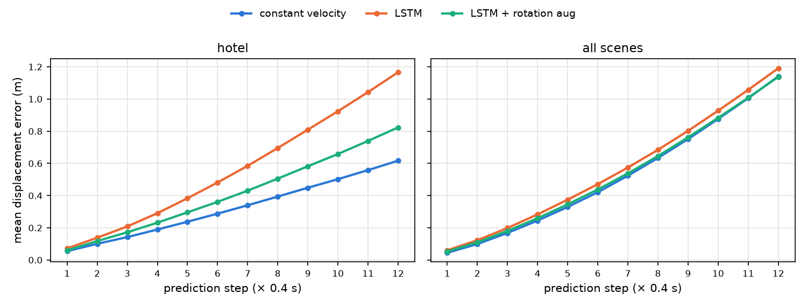
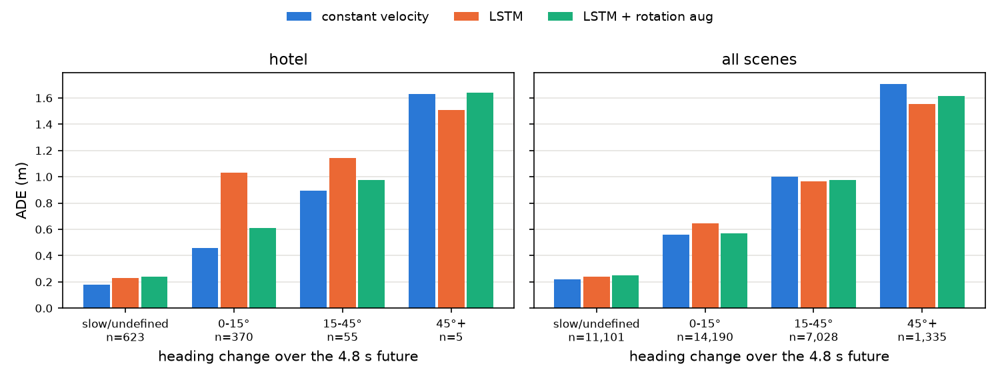
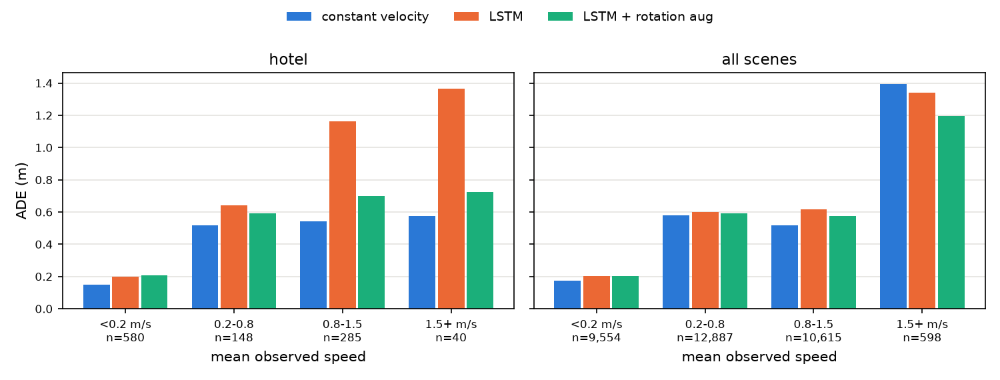
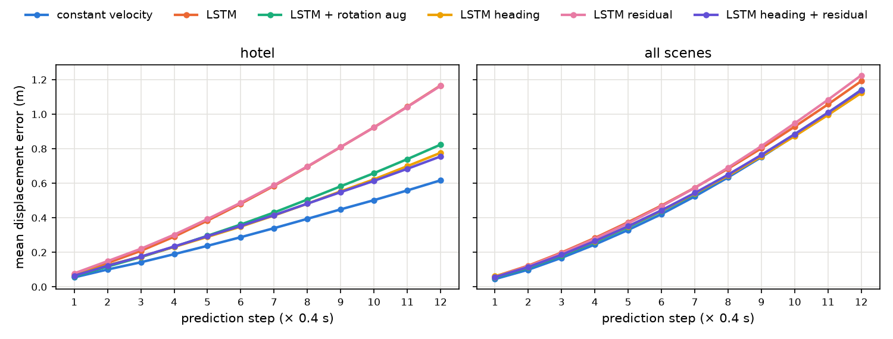
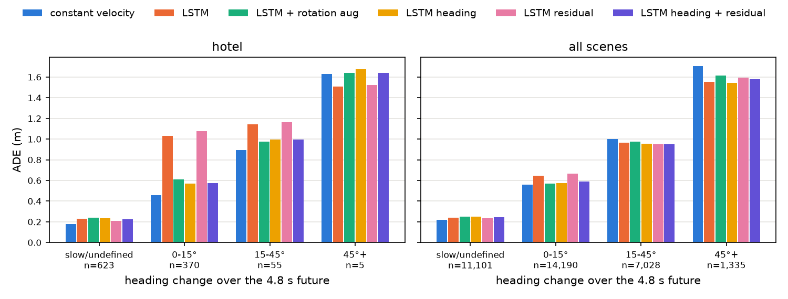
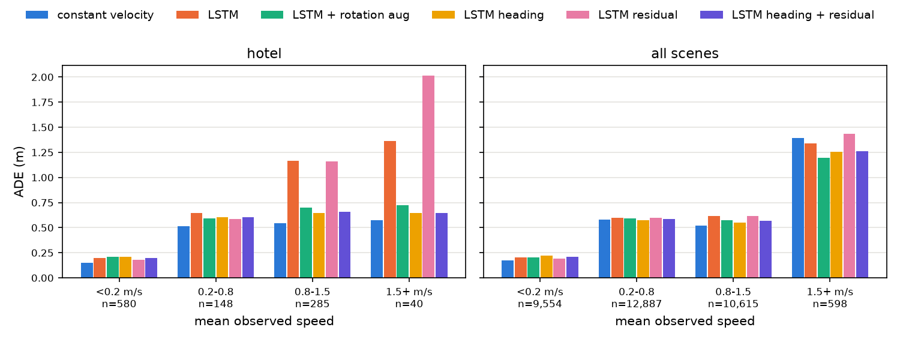

# A단계: LSTM 오차 분석

LSTM이 등속 모델을 언제 이기고 언제 지는지를 오차 분해로 확인했다. 진행 방향 정규화(heading frame)와 residual 예측이 그 차이를 얼마나 줄이는지도 쟀다. 모든 수치는 이 저장소에서 실제로 실행한 값이다. 각 절 끝에 **확인한 것**과 **추측**을 나눠 적었다.

- 데이터 · 평가: README와 같은 leave-one-out 5개 분할, 같은 ADE/FDE(m)
- 다시 만드는 법:

```bash
# 학습 (조건마다 시드 0, 1, 2)
.venv/bin/python scripts/train_lstm.py --seed 0                          # 증강 없음
.venv/bin/python scripts/train_lstm.py --augment rotate --seed 0         # 회전 증강
.venv/bin/python scripts/train_lstm.py --frame heading --seed 0          # heading
.venv/bin/python scripts/train_lstm.py --residual --seed 0               # residual
.venv/bin/python scripts/train_lstm.py --frame heading --residual --seed 0
.venv/bin/python scripts/summarize_lstm.py                               # 3절 표

# 오차 분해 (시드 0 체크포인트 사용)
.venv/bin/python scripts/analyze_errors.py > results/analysis/main_report.md
.venv/bin/python scripts/analyze_errors.py --tag all --runs none_seed0 rotate_seed0 \
    none_heading_seed0 none_residual_seed0 none_heading_residual_seed0 > results/analysis/all_report.md
```

`results/analysis/*_report.md`에 아래 모든 표의 원본 출력이, `*_bins.csv`와 `*_steps.csv`에 장면별 값까지 들어 있다.

## 0. 용어

| 용어 | 뜻 |
| :--- | :--- |
| hotel | hotel test 샘플만(1,053개) |
| all scenes | 5개 test 장면을 **같은 비중으로** 합친 값(샘플 가중치 1 / 장면 샘플 수). 전체 ADE가 README 표의 AVG와 같다. univ가 샘플의 72%라서 단순히 합치면 사실상 univ 값이 된다 |
| 방향 전환 각도 | 마지막 관측 변위의 방향과, 마지막 관측점에서 실제 마지막 미래점(4.8 s 뒤)으로 가는 방향 사이의 각. 마지막 관측 변위가 0.08 m(0.2 m/s) 미만이거나 4.8 s 동안 0.5 m 미만 움직이면 방향이 정해지지 않으므로 `slow/undefined`로 따로 묶는다 |
| 관측 속력 | 관측 8점의 평균 속력 |
| along / cross | 마지막 스텝 오차(예측 − 실제)를 마지막 관측 진행 방향으로 나눈 성분. along이 +이면 예측이 실제보다 앞으로 더 갔다는 뜻이다 |

## 1. 오차 분해: 등속 / LSTM 증강 없음 / LSTM 회전 증강 (시드 0)

### 1.1 예측 스텝별 오차



| | 모델 | step 1 | step 4 | step 8 | step 12 | ADE |
| :--- | :--- | --: | --: | --: | --: | --: |
| hotel | 등속 | **0.055** | **0.189** | **0.394** | **0.617** | **0.323** |
| | LSTM | 0.072 | 0.291 | 0.696 | 1.166 | 0.566 |
| | LSTM + 회전 증강 | 0.060 | 0.232 | 0.506 | 0.824 | 0.415 |
| all scenes | 등속 | **0.045** | **0.245** | **0.634** | 1.141 | **0.520** |
| | LSTM | 0.060 | 0.283 | 0.684 | 1.192 | 0.562 |
| | LSTM + 회전 증강 | 0.053 | 0.259 | 0.646 | **1.138** | 0.530 |

- 등속 모델은 첫 스텝(0.4 s 뒤)부터 가장 정확하다. 첫 스텝은 사실상 "마지막 변위를 한 번 더 간다"이므로 이보다 나은 단기 예측은 어렵다.
- all scenes에서 회전 증강 LSTM은 스텝이 지날수록 등속 모델과의 차이를 좁혀 step 12에서 따라잡는다(1.138 대 1.141). hotel에서는 처음부터 끝까지 차이가 커진다.

### 1.2 방향 전환 각도별 ADE



| | 각도 | n | 등속 | LSTM | LSTM + 회전 증강 |
| :--- | :--- | --: | --: | --: | --: |
| hotel | slow/undefined | 623 | **0.180** | 0.232 | 0.239 |
| | 0–15° | 370 | **0.460** | 1.031 | 0.611 |
| | 15–45° | 55 | **0.896** | 1.143 | 0.976 |
| | 45°+ | 5 | 1.629 | **1.506** | 1.638 |
| all scenes | slow/undefined | 11,101 | **0.218** | 0.240 | 0.247 |
| | 0–15° | 14,190 | **0.561** | 0.647 | 0.571 |
| | 15–45° | 7,028 | 1.003 | **0.967** | 0.976 |
| | 45°+ | 1,335 | 1.705 | **1.556** | 1.617 |

- all scenes에서 **LSTM은 15° 이상 꺾는 샘플에서 등속 모델을 이기고, 직진(0–15°)과 정지 · 저속 샘플에서 진다.** 직진 샘플에서는 등속 가정이 거의 맞으므로 등속 모델이 유리하다.
- hotel은 대부분 직진(35%)이거나 정지 · 저속(59%)이다. 15° 이상 꺾는 샘플은 6%뿐이다. LSTM이 이기는 상황이 hotel에는 거의 없다. 45°+ 칸은 hotel에서 5개뿐이라 비교에 쓰지 않는다.

### 1.3 관측 속력별 ADE



| | 속력 | n | 등속 | LSTM | LSTM + 회전 증강 |
| :--- | :--- | --: | --: | --: | --: |
| hotel | < 0.2 m/s | 580 | **0.148** | 0.198 | 0.208 |
| | 0.2–0.8 | 148 | **0.516** | 0.643 | 0.590 |
| | 0.8–1.5 | 285 | **0.541** | 1.164 | 0.701 |
| | 1.5+ m/s | 40 | **0.577** | 1.365 | 0.725 |
| all scenes | < 0.2 m/s | 9,554 | **0.175** | 0.201 | 0.205 |
| | 0.2–0.8 | 12,887 | **0.581** | 0.600 | 0.590 |
| | 0.8–1.5 | 10,615 | **0.519** | 0.616 | 0.576 |
| | 1.5+ m/s | 598 | 1.393 | 1.341 | **1.195** |

- all scenes에서 LSTM이 이기는 속력 구간은 1.5 m/s 이상(샘플 598개)뿐이다. 개수로는 univ 203, zara2 188, zara1 87, eth 80, hotel 40이지만, 장면 동일 비중으로 가중하면 이 구간 가중치의 약 80%가 eth다(eth test 샘플의 44%가 이 구간).
- hotel에서는 모든 속력 구간에서 진다. 증강 없는 LSTM은 0.8 m/s 이상에서 오차가 등속의 2배를 넘는다. 회전 증강이 이 부분을 크게 줄였다(1.164 → 0.701).

**확인한 것**

- 등속 모델은 단기(앞쪽 스텝), 직진, 정지 · 저속 상황에서 LSTM보다 정확하다. LSTM은 15° 이상 꺾는 상황과 아주 빠른 보행자(1.5 m/s+)에서 낫다. all scenes와 hotel 모두에서 같은 경향이다.
- hotel 샘플은 94%가 직진 또는 정지 · 저속이다. LSTM에 불리한 상황이 대부분이다.

## 2. 진행 방향 정규화(heading frame)와 residual

### 2.1 무엇을 바꿨나

`src/trajpred/models/lstm.py`에 두 옵션을 넣었다. 학습 스크립트에서는 `--frame heading`, `--residual`로 켠다.

- **heading frame**: 샘플마다 마지막 관측 변위가 +x를 향하도록 궤적을 마지막 관측점 중심으로 돌려 넣고, 예측을 반대로 돌려 원래 좌표로 되돌린다. 모델은 "앞 · 옆" 좌표만 보므로 장면의 좌표축 방향을 외울 수 없다. 마지막 변위가 1 mm 미만(사실상 정지)이면 방향이 정해지지 않아 돌리지 않는다. 회전 증강과 달리 학습과 평가 모두에 적용되는 결정적 변환이다. 입력을 돌리면 예측도 정확히 같이 도는지(회전 등변성)를 코드로 확인했다.
- **residual**: 디코더가 스텝마다 "마지막 관측 변위(= 등속 변위)에 더할 보정량"을 낸다. 출력층을 0으로 초기화해서 학습 시작 시점의 예측이 등속 모델과 정확히 같다(코드로 확인).

### 2.2 결과 (시드 0, 1, 2)

ADE (m). LSTM은 시드 3개의 평균 ± 표본 표준편차이고, 굵은 글씨는 장면마다 가장 작은 평균이다.

| 장면 | 등속 | 증강 없음 | 회전 증강 | heading | residual | heading + residual |
| :--- | :-: | :-: | :-: | :-: | :-: | :-: |
| eth | 0.995 | 0.944 ± 0.010 | **0.918 ± 0.015** | 0.951 ± 0.045 | 0.949 ± 0.024 | 0.937 ± 0.014 |
| hotel | **0.323** | 0.565 ± 0.004 | 0.418 ± 0.006 | 0.387 ± 0.013 | 0.534 ± 0.071 | 0.397 ± 0.008 |
| univ | 0.524 | 0.545 ± 0.010 | 0.514 ± 0.004 | 0.517 ± 0.004 | 0.534 ± 0.002 | **0.509 ± 0.003** |
| zara1 | 0.431 | 0.437 ± 0.022 | 0.456 ± 0.005 | 0.456 ± 0.006 | **0.430 ± 0.006** | 0.466 ± 0.007 |
| zara2 | **0.326** | 0.347 ± 0.010 | 0.335 ± 0.008 | 0.346 ± 0.006 | 0.332 ± 0.012 | 0.341 ± 0.002 |
| **AVG** | **0.520** | 0.568 ± 0.005 | 0.528 ± 0.002 | 0.531 ± 0.009 | 0.556 ± 0.021 | 0.530 ± 0.003 |

FDE (m)

| 장면 | 등속 | 증강 없음 | 회전 증강 | heading | residual | heading + residual |
| :--- | :-: | :-: | :-: | :-: | :-: | :-: |
| eth | 2.234 | 1.949 ± 0.046 | 1.921 ± 0.055 | **1.901 ± 0.067** | 2.080 ± 0.051 | 1.952 ± 0.061 |
| hotel | **0.617** | 1.152 ± 0.013 | 0.806 ± 0.019 | 0.749 ± 0.028 | 1.069 ± 0.149 | 0.759 ± 0.012 |
| univ | 1.165 | 1.184 ± 0.021 | 1.127 ± 0.010 | 1.129 ± 0.010 | 1.160 ± 0.004 | **1.118 ± 0.007** |
| zara1 | 0.960 | 0.957 ± 0.051 | 1.021 ± 0.013 | 1.032 ± 0.020 | **0.939 ± 0.016** | 1.048 ± 0.021 |
| zara2 | **0.729** | 0.769 ± 0.036 | 0.740 ± 0.016 | 0.751 ± 0.012 | 0.731 ± 0.023 | 0.759 ± 0.010 |
| **AVG** | 1.141 | 1.202 ± 0.017 | 1.123 ± 0.019 | **1.112 ± 0.015** | 1.196 ± 0.044 | 1.127 ± 0.012 |

새 조건을 포함한 오차 분해 그림(시드 0)은 다음과 같다.





### 2.3 해석

- **heading frame은 회전 증강과 같은 문제를 같은 정도로 푼다.** hotel ADE는 0.565에서 0.387 ± 0.013으로 줄었다(회전 증강 0.418 ± 0.006). AVG는 회전 증강, heading, heading + residual이 0.528~0.531로 시드 편차 안에서 같다. 장면별로도 univ에서 좋아지고 zara1에서 나빠지는 패턴이 회전 증강과 같다. eth는 heading(0.951 ± 0.045)이 증강 없음(0.944)과 같은 수준이다.
- **residual만으로는 방향 편향이 풀리지 않는다.** 월드 좌표 residual의 hotel ADE는 시드 0, 1에서 0.571, 0.579로 증강 없음(0.565)과 같다. 등속에서 출발하더라도, 학습하면서 결국 좌표축 방향에 맞춘 보정을 배운다.
- **residual의 hotel 표준편차(0.071)가 큰 이유**: 시드 2는 early stopping이 **에폭 1**의 모델을 골랐다. 이 모델은 출력층이 0에서 시작했으므로 아직 등속에 가깝고, hotel ADE가 0.452로 나왔다. 나머지 두 시드는 에폭 15, 18을 골라 0.571, 0.579다. hotel 분할의 val ADE는 에폭에 따라 0.44~0.46 사이에서 오르내리기만 한다(`results/lstm/none_residual_seed*_history.csv`). 그래서 어느 에폭이 뽑힐지는 사실상 잡음이 정하고, test(hotel) 값은 그에 따라 크게 달라진다.
- **heading + residual은 heading과 같은 수준이다**(AVG 0.530 ± 0.003 대 0.531 ± 0.009, hotel 0.397 ± 0.008 대 0.387 ± 0.013). residual을 더해서 얻은 것은 시드 간 편차가 조금 줄어든 정도다.
- **어떤 조건도 등속 모델의 AVG ADE(0.520)를 넘지 못했다.** AVG FDE는 heading(1.112 ± 0.015)과 회전 증강(1.123 ± 0.019)이 등속(1.141)보다 낮다. 차이는 표준편차의 1~2배다.

**확인한 것**

- heading frame과 회전 증강은 hotel의 방향 편향을 비슷한 정도로 줄인다. residual만으로는 줄지 않는다.
- residual의 큰 시드 편차는 early stopping이 고른 에폭 차이 때문이다(에폭 1 대 15~18). val ADE가 평평해서 생긴다.

## 3. hotel의 남은 차이는 어디서 오나

heading + residual(시드 0)의 hotel ADE는 0.395로 등속(0.323)보다 0.072 크다. 이 차이를 나눠 봤다.

### 3.1 상황별 기여

샘플마다 (모델 ADE − 등속 ADE)를 구해 묶음별로 더하고 전체 샘플 수로 나눴다. 묶음별 기여를 다 더하면 전체 차이가 된다.

| 관측 속력 | 샘플 비율 | 증강 없음 | 회전 증강 | heading | residual | heading + residual |
| :--- | --: | --: | --: | --: | --: | --: |
| < 0.2 m/s | 55% | +0.027 | +0.033 | +0.033 | +0.016 | +0.026 |
| 0.2–0.8 | 14% | +0.018 | +0.010 | +0.012 | +0.010 | +0.012 |
| 0.8–1.5 | 27% | +0.168 | +0.043 | +0.028 | +0.168 | +0.031 |
| 1.5+ m/s | 4% | +0.030 | +0.006 | +0.003 | +0.055 | +0.003 |
| **합** | | +0.244 | +0.092 | +0.076 | +0.249 | +0.072 |

| 방향 전환 | 샘플 비율 | 증강 없음 | 회전 증강 | heading | residual | heading + residual |
| :--- | --: | --: | --: | --: | --: | --: |
| slow/undefined | 59% | +0.031 | +0.035 | +0.033 | +0.018 | +0.026 |
| 0–15° | 35% | +0.201 | +0.053 | +0.038 | +0.217 | +0.041 |
| 15–45° | 5% | +0.013 | +0.004 | +0.005 | +0.014 | +0.005 |
| 45°+ | 0.5% | −0.001 | +0.000 | +0.000 | −0.001 | +0.000 |

방향 편향을 없앤 뒤(heading + residual) 남은 +0.072는 크게 두 덩어리다. **정지 · 저속 보행자(0.2 m/s 미만 +0.026)**와 **0.8 m/s 이상 보행자(+0.031 + 0.003)**다. 방향 전환으로 보면 직진(0–15°) 샘플이 +0.041이다.

### 3.2 정지 · 저속 보행자: LSTM이 서 있는 사람을 움직이게 한다

관측 평균 속력이 0.2 m/s 미만인 샘플의 4.8 s 이동 거리 평균(m):

| | n | 실제 | 등속 | LSTM | 회전 증강 | heading | residual | heading + residual |
| :--- | --: | --: | --: | --: | --: | --: | --: | --: |
| hotel | 580 | **0.071** | 0.223 | 0.315 | 0.365 | 0.370 | 0.272 | 0.323 |
| all scenes | 9,554 | **0.324** | 0.228 | 0.262 | 0.285 | 0.303 | 0.248 | 0.296 |

- hotel의 저속 보행자는 실제로 거의 움직이지 않는다(4.8 s에 7 cm). 등속 모델도 측정 잡음을 이어 가서 22 cm를 가지만, LSTM은 27~37 cm를 간다.
- 다른 장면까지 합치면 저속 보행자는 4.8 s에 평균 32 cm를 움직인다. 멈췄다가 다시 걷는 경우가 섞여 있기 때문이다. LSTM의 예측(25~30 cm)은 이 평균에 가깝다.
- residual이 이 구간의 기여를 줄인다(+0.033 → +0.016~0.026). 등속에서 출발하므로 "거의 정지"라는 출력을 쉽게 유지하기 때문일 수 있다(추측).

### 3.3 직진 보행자: 속도를 줄여 예측하고, 옆으로도 더 벗어난다

마지막 관측 변위가 0.08 m 이상인 hotel 샘플 493개의 마지막 스텝 오차를 진행 방향 성분으로 나눴다.

| 모델 | along 평균 | 평균 abs(along) | 평균 abs(cross) |
| :--- | --: | --: | --: |
| 등속 | +0.417 | **0.760** | **0.585** |
| LSTM | −0.921 | 1.570 | 1.255 |
| 회전 증강 | −0.259 | 1.035 | 0.721 |
| heading | −0.114 | 0.896 | 0.704 |
| heading + residual | −0.096 | 0.900 | 0.705 |

4.8 s 이동 거리를 등속 이동 거리(12 × 마지막 관측 변위)에 직선 회귀한 기울기다. 1이면 관측 속도를 그대로 따르고, 1보다 작으면 속도를 평균 쪽으로 줄여 예측한다는 뜻이다.

| | hotel (n=493) | all scenes (n=23,334) |
| :--- | --: | --: |
| 실제 미래 | **1.08** | **0.71** |
| 등속 | 1.00 | 1.00 |
| LSTM | 0.59 | 0.80 |
| 회전 증강 | 0.80 | 0.81 |
| heading | 0.88 | 0.81 |
| heading + residual | 0.88 | 0.84 |

같은 기울기를 test 분할과 train 분할(나머지 4개 장면)의 실제 미래에서 쟀다.

| 장면 | test 기울기 (n) | train 기울기 (n) |
| :--- | --: | --: |
| eth | 0.61 (133) | 0.86 (21,101) |
| hotel | **1.08** (493) | 0.85 (20,778) |
| univ | 0.77 (17,738) | 0.88 (6,186) |
| zara1 | 0.88 (2,074) | 0.84 (19,419) |
| zara2 | 0.90 (2,896) | 0.84 (18,874) |

- **hotel 보행자는 관측 속도를 그대로 유지한다**(기울기 1.08). 다른 장면의 학습 데이터는 0.84~0.88이다. 빠르게 관측된 사람일수록 실제로는 그만큼 멀리 가지 않는다. 마지막 변위의 측정 잡음과 실제 감속이 섞인 결과로 보인다.
- LSTM은 학습 데이터의 이 관계(약 0.85)를 배워 hotel에서도 속도를 줄여 예측한다(0.88). 그래서 along 오차의 평균은 0에 가깝지만 샘플별 크기(abs)는 등속보다 크다. 등속은 평균적으로 더 멀리 가지만(+0.417) 샘플마다 속도에 비례해서 맞히므로 abs가 작다.
- **속도 줄이기만으로 몇 cm가 나오나**: 학습 없이 등속 모델의 속도에 k를 곱해 봤다. hotel ADE는 k = 1.0에서 0.323, 0.88에서 0.339, 0.85에서 0.354다. LSTM의 기울기(0.88)에 해당하는 k로는 **약 +0.016**이다. 남은 +0.072 가운데 일부일 뿐이다.
- 옆 방향 오차도 LSTM이 더 크다(abs(cross) 0.705 대 0.585).

| k | eth | hotel | univ | zara1 | zara2 | AVG |
| --: | --: | --: | --: | --: | --: | --: |
| 1.0 | 0.995 | 0.323 | 0.524 | 0.431 | 0.326 | 0.520 |
| 0.9 | 0.933 | 0.331 | 0.507 | 0.483 | 0.341 | 0.519 |
| 0.88 | 0.934 | 0.339 | 0.509 | 0.510 | 0.352 | 0.529 |
| 0.85 | 0.942 | 0.354 | 0.514 | 0.556 | 0.372 | 0.548 |
| 0.8 | 0.972 | 0.384 | 0.531 | 0.644 | 0.411 | 0.588 |

(곱하는 k는 모든 샘플에 같다. LSTM처럼 회귀 절편이 있는 줄이기와는 모양이 달라 대략적인 비교다.)

### 3.4 정리

**확인한 것**

1. 증강 없는 LSTM의 hotel 차이(+0.244)는 대부분 0.8 m/s 이상 보행자(+0.198)와 직진 보행자(0–15°, +0.201)에서 나왔다. 이 부분은 heading frame이나 회전 증강으로 대부분 사라진다(각각 +0.031~0.049, +0.038~0.053). 즉 방향 편향이었다.
2. 방향 편향을 없앤 뒤 남는 +0.072(heading + residual, 시드 0)는 관측 속력으로 나누면 0.2 m/s 미만(+0.026)과 0.8 m/s 이상(+0.034)에서, 방향 전환으로 나누면 직진(+0.041)과 slow/undefined(+0.026)에서 나온다.
3. hotel의 정지 보행자는 실제로 거의 움직이지 않는데(7 cm), LSTM은 27~37 cm를 움직이게 예측한다. 다른 장면의 저속 보행자는 평균 32 cm를 움직인다.
4. hotel 보행자는 관측 속도를 유지하는데(기울기 1.08), 학습 데이터는 0.85이고 LSTM은 0.88로 줄여 예측한다. 등속 모델을 같은 정도로 줄이면 hotel ADE가 약 0.016 늘어난다.
5. hotel에서 LSTM의 옆 방향 오차(0.705)가 등속(0.585)보다 크다.

**추측(확인하지 않음)**

- LSTM은 "학습 장면의 평균적인 보행자"를 배운다. 저속 보행자는 곧 움직이고, 빠른 보행자는 곧 느려진다는 식이다. hotel은 이 평균에서 벗어난 장면이다(정지한 사람은 계속 서 있고, 걷는 사람은 속도를 유지). 위 3, 4가 이 설명과 맞지만, 이것만으로 남은 차이 전부가 설명되는지는 따로 실험하지 않았다.
- 옆 방향 오차가 큰 것은, 학습 장면(특히 univ · zara)의 휘어지는 경로에서 배운 "약간 꺾는" 경향 때문일 수 있다. 예측 곡률을 직접 재 보지는 않았다.
- early stopping 기준(val)이 test 장면과 다른 분포라는 점도 영향을 줄 수 있다. val ADE가 에폭에 따라 거의 변하지 않아 모델 선택이 잡음에 가깝다. hotel을 닮은 검증 데이터가 있다면 결과가 달라질 수 있지만, test를 검증에 쓰는 것은 규칙 위반이라 하지 않았다.

## 4. 언제 LSTM이 등속을 이기고 지나

| 상황 | 결과 | 근거 |
| :--- | :--- | :--- |
| 15° 이상 방향을 바꾸는 보행자 | **LSTM이 이긴다** | all scenes 15–45°: 0.948~0.976 대 1.003, 45°+: 1.54~1.64 대 1.705 (시드 0, 모든 LSTM 조건) |
| 아주 빠른 보행자(1.5 m/s+, 주로 eth) | **LSTM이 이긴다**(residual 제외) | all scenes 1.195~1.341 대 1.393 |
| eth, univ 장면 | **LSTM이 이긴다** | 회전 증강 · heading · heading + residual, 시드 3개 평균이 시드 편차보다 크게 낮음 |
| 직진(0–15°) | 등속이 이긴다 | all scenes 0.561 대 0.571~0.666 |
| 정지 · 저속 | 등속이 이긴다 | all scenes 0.218 대 0.232~0.249 |
| 짧은 예측 구간(앞쪽 스텝) | 등속이 이긴다 | step 1: 0.045 대 0.053~0.062 (all scenes) |
| hotel 장면 | 등속이 이긴다 | 모든 조건, 모든 시드 |
| zara1, zara2 | 비슷하다 | 차이가 시드 편차 정도 |

ETH/UCY 보행자는 대부분 직진하거나 서 있다. 5개 test 장면을 단순 합계하면 15° 이상 꺾는 샘플은 33,654개 중 8,363개(25%)다. 그래서 꺾는 상황에서 LSTM이 얻는 이득이 직진 · 정지 상황에서 잃는 손해에 묻히고, AVG ADE는 등속을 넘지 못한다.

다음 단계(B, 상호작용)에서 확인할 질문은 이것이다. 주변 보행자 정보가 "언제 꺾을지"를 알려 주면 꺾는 샘플의 이득이 커질 수 있다. 반대로 직진 · 정지 샘플의 손해(속도 줄이기, 정지한 사람 움직이기)는 상호작용과 무관한 문제라 따로 다뤄야 한다.
