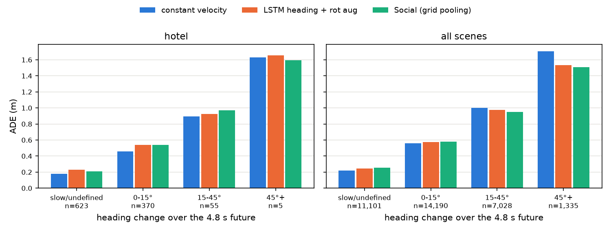
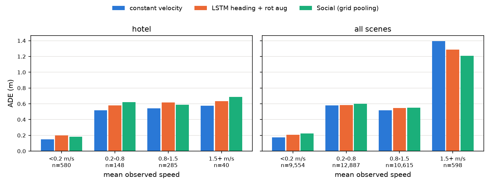
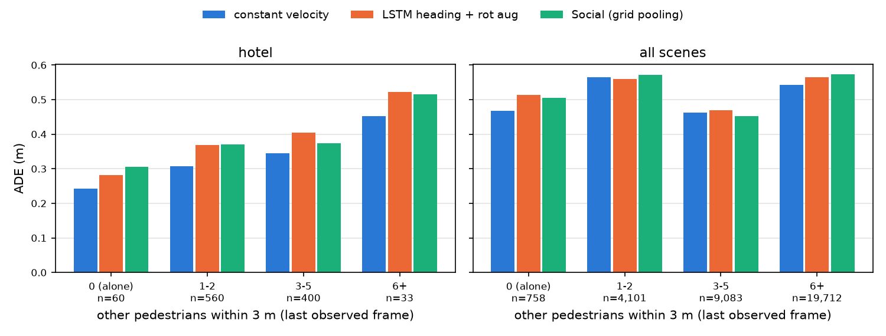

# B단계: 주변 보행자 정보 (grid pooling)

같은 프레임 주변 보행자의 상대 위치와 속도를 격자로 모아 LSTM 인코더에 넣었다. 기본 설정은 heading frame + 회전 증강이다. 모든 수치는 이 저장소에서 실제로 실행한 값이다. 확인한 것과 추측은 나눠 적었다.

**결론**: 이웃 정보를 넣어도 평균 성능은 이웃 없는 모델과 같았다(AVG ADE 0.531 ± 0.002). A단계에서 LSTM이 이기던 15° 이상 꺾는 샘플에서도 개선이 없었다. 첫 설정(8×8 격자)은 학습 데이터를 빠르게 외워 val이 나빠졌다. 격자를 줄이고 dropout을 넣어서야 이웃 없는 모델과 비슷해졌다.

```bash
# 이웃 없는 기준 (heading + 회전 증강)
.venv/bin/python scripts/train_lstm.py --frame heading --augment rotate --seed 0
# 이웃 grid pooling (val 로 고른 설정)
.venv/bin/python scripts/train_lstm.py --frame heading --augment rotate --social \
    --grid-size 4 --cell 1.5 --social-dropout 0.5 --tag g4d5 --seed 0
# 오차 분해 (시드마다) 와 시드 묶기
for s in 0 1 2; do
  .venv/bin/python scripts/analyze_errors.py --tag B_seed$s \
      --runs rotate_heading_seed$s rotate_heading_social_g4d5_seed$s > results/analysis/B_seed${s}_report.md
done
.venv/bin/python scripts/compare_bins.py --tags B_seed0 B_seed1 B_seed2 \
    --conditions rotate_heading rotate_heading_social_g4d5
```

## 1. 무엇을 만들었나

### 이웃 데이터 (`src/trajpred/data.py`의 `extract_neighbors`)

- 샘플마다 관측 8프레임 각각에서, 그 프레임에 있는 **모든 다른 보행자**를 이웃으로 모은다. 20프레임을 다 채운 보행자만 쓰는 것이 아니다. 관측 프레임만 쓰므로 미래 정보는 들어가지 않는다.
- 이웃마다 상대 위치(이웃 − 대상, 같은 프레임)와 속도(직전 프레임과의 차이)를 저장한다. 직전 프레임에 없던 이웃은 속도를 0으로 둔다. 가까운 순서로 32명까지 남긴다. 5개 test 장면 모두에서 대상 주변 ±3 m 상자 안의 이웃은 최대 32명이라, 격자 범위 안에서 잘리는 이웃은 없다.
- 무작위 샘플 5개를 원본 파일과 직접 대조해 가장 가까운 이웃의 위치 · 속도와 이웃 수가 맞는지 확인했다.

### grid pooling (`src/trajpred/models/lstm.py`의 `social_grid`)

- 관측 스텝마다 대상 보행자를 중심으로 G×G 격자를 놓고, 칸마다 (이웃 수, 평균 상대 속도 x, y)를 센다. 상대 속도는 이웃 속도에서 대상 속도를 뺀 값이다.
- 격자를 펼친 벡터(G·G·3)를 `Linear + ReLU`로 64차원에 임베딩하고, 변위 임베딩과 이어 붙여 인코더 LSTM에 넣는다. 디코더에는 넣지 않는다(미래의 이웃 위치를 모른다).
- heading frame이면 이웃의 상대 위치 · 속도도 같은 회전으로 돌린다. 격자 축이 대상의 진행 방향("앞 · 옆")에 맞춰진다. 회전 증강도 이웃을 같은 각도로 돌린다. 입력과 이웃을 함께 돌리면 예측도 같이 돈다는 것(회전 등변성)을 코드로 확인했다.
- Social LSTM(Alahi et al., 2016)은 이웃의 LSTM **은닉 상태**를 격자에 모은다. 여기서는 더 간단하게 이웃의 위치 · 속도를 직접 쓴다.

## 2. 첫 설정의 과적합과 설정 고르기

### 2.1 8×8 격자는 학습 데이터를 외웠다

첫 설정(8×8 격자, 칸 0.75 m, ±3 m)으로 시드 0을 돌렸더니 다섯 분할 모두에서 early stopping이 에폭 1~3(univ만 22)의 모델을 골랐다. test AVG ADE는 0.570으로 이웃 없는 모델(0.529)보다 나빴다.

hotel 분할에서 처음 8에폭을 비교했다(`results/lstm/social_sweep/diag_*.log`).

| 에폭 | 이웃 없음 train loss | 이웃 (진짜) train loss | 이웃 (진짜) val ADE | 이웃 (섞음) train loss | 이웃 (섞음) val ADE |
| --: | --: | --: | --: | --: | --: |
| 1 | 0.391 | 0.370 | **0.471** | 0.368 | 0.516 |
| 4 | 0.316 | 0.255 | 0.494 | 0.308 | 0.483 |
| 8 | 0.308 | **0.184** | 0.512 | 0.272 | 0.495 |

"섞음"은 진단용 설정(`--neighbor-control shuffle`)이다. 샘플마다 이웃 정보를 다른 무작위 샘플의 것으로 바꿔서, 뜻은 없지만 샘플마다 고정된 입력이 되게 한다.

- 진짜 이웃을 넣으면 train loss가 이웃 없는 모델보다 훨씬 빨리 내려간다(8에폭에 0.184 대 0.308). 그런데 val ADE는 에폭 1이 가장 좋고 그 뒤로 나빠진다.
- 이웃 정보가 미래를 새어 나르는 것이라면 같은 방식으로 만든 val도 좋아져야 한다. val이 나빠지므로 정보 누설보다는 **학습 데이터에만 통하는 무언가를 외운 것**이다.
- 뜻 없는 이웃(섞음)으로도 train loss가 이웃 없는 모델보다 내려간다(0.272). 샘플마다 고정된 고차원 입력은 그 자체로 샘플을 구분하는 "지문" 역할을 해서 외우기를 돕는다. 진짜 이웃은 이보다 훨씬 더 빨리 내려간다(0.184).

### 2.2 val로 설정 고르기 (시드 0)

과적합을 줄이려고 격자를 줄이고(4×4, 칸 1.5 m, 범위는 같은 ±3 m) 격자 임베딩 앞에 dropout을 넣는 조합을 시험했다. **고르는 기준은 val ADE(5개 분할의 best val ADE 평균)만 썼다.** test 값은 참고용으로 같이 적는다.

| 설정 | eth | hotel | univ | zara1 | zara2 | val 평균 | (test AVG ADE) |
| :--- | --: | --: | --: | --: | --: | --: | --: |
| 이웃 없음 (기준) | 0.4412 | 0.4542 | 0.3834 | 0.4513 | 0.4922 | **0.4444** | 0.529 |
| 8×8, 0.75 m, dropout 0 | 0.4637 | 0.4697 | 0.4266 | 0.4778 | 0.5274 | 0.4731 | 0.570 |
| 4×4, 1.5 m, dropout 0 | 0.4484 | 0.4557 | 0.4076 | 0.4571 | 0.5076 | 0.4553 | 0.552 |
| 8×8, 0.75 m, dropout 0.5 | 0.4471 | 0.4631 | 0.3974 | 0.4592 | 0.4929 | 0.4519 | 0.540 |
| **4×4, 1.5 m, dropout 0.5** | 0.4433 | 0.4588 | 0.3855 | 0.4564 | 0.4944 | 0.4477 | 0.529 |

- **이웃을 넣은 어떤 설정도 val에서 이웃 없는 모델보다 낫지 않았다.** 가장 가까운 4×4 + dropout 0.5를 골라 시드 1, 2를 더 돌렸다.
- val 순위와 test 순위는 같았다. val로 고른 것이 test와 어긋나지 않았다.
- 고른 설정도 early stopping이 고른 에폭이 이르다. 시드 3개 × 5개 분할에서 중앙값 9(범위 2~17)이고, 이웃 없는 기준은 중앙값 27(3~42)이다. 과적합이 줄었을 뿐 사라지지는 않았다.

## 3. 결과 (시드 0, 1, 2)

ADE (m), 평균 ± 표본 표준편차. 전체 조건 표는 README에 있다.

| 장면 | 등속 | heading | heading + 회전 증강 (기준) | + social pooling |
| :--- | :-: | :-: | :-: | :-: |
| eth | 0.995 | 0.951 ± 0.045 | 0.998 ± 0.078 | **0.909 ± 0.011** |
| hotel | **0.323** | 0.387 ± 0.013 | 0.392 ± 0.010 | 0.387 ± 0.013 |
| univ | 0.524 | **0.517 ± 0.004** | 0.525 ± 0.009 | 0.546 ± 0.008 |
| zara1 | **0.431** | 0.456 ± 0.006 | 0.462 ± 0.029 | 0.451 ± 0.010 |
| zara2 | **0.326** | 0.346 ± 0.006 | 0.340 ± 0.006 | 0.360 ± 0.005 |
| **AVG** | **0.520** | 0.531 ± 0.009 | 0.543 ± 0.014 | 0.531 ± 0.002 |

FDE (m)

| 장면 | 등속 | heading | heading + 회전 증강 (기준) | + social pooling |
| :--- | :-: | :-: | :-: | :-: |
| eth | 2.234 | 1.901 ± 0.067 | 1.967 ± 0.125 | **1.853 ± 0.035** |
| hotel | **0.617** | 0.749 ± 0.028 | 0.748 ± 0.020 | 0.739 ± 0.036 |
| univ | 1.165 | 1.129 ± 0.010 | 1.142 ± 0.019 | 1.161 ± 0.015 |
| zara1 | **0.960** | 1.032 ± 0.020 | 1.028 ± 0.070 | 0.984 ± 0.026 |
| zara2 | **0.729** | 0.751 ± 0.012 | 0.761 ± 0.026 | 0.797 ± 0.034 |
| **AVG** | 1.141 | 1.112 ± 0.015 | 1.129 ± 0.020 | **1.107 ± 0.009** |

- **heading 단독과 heading + 회전 증강의 차이는 시드 잡음이다.** heading frame에서는 회전 증강이 거의 아무것도 바꾸지 않는다. 진행 방향으로 다시 돌리므로, 영향을 받는 것은 마지막 변위가 1 mm 미만인 학습 샘플(2~3%)뿐이다. 다만 난수 사용 순서가 바뀌어 학습 경로가 달라진다. 기준 조건의 eth 표준편차가 큰 것(0.078)은 시드 2의 eth가 1.088로 나빴기 때문이다. eth test는 181개뿐이라 시드에 민감하다(heading 단독도 0.922, 0.929, 1.002).
- **social pooling의 AVG ADE는 0.531 ± 0.002로 heading 단독(0.531 ± 0.009)과 같다.** 기준 조건(0.543 ± 0.014)보다는 낮지만, 그 차이의 대부분은 기준 조건의 eth 시드 2에서 온다.
- 장면별로는 **eth에서 낫고**(0.909 ± 0.011, 세 조건 중 가장 낮고 편차도 작다), **univ · zara2에서 나쁘다**(0.546, 0.360으로 시드 편차보다 크게 나쁨). hotel · zara1은 비슷하다.
- AVG FDE는 social이 1.107 ± 0.009로 가장 낮지만, heading(1.112 ± 0.015)과의 차이는 표준편차 안이다.
- 여전히 어떤 조건도 AVG ADE에서 등속 모델(0.520)을 넘지 못했다.

## 4. A단계 기준으로 다시 나눠 보기

기준(heading + 회전 증강)과 social을 시드 3개 각각 오차 분해하고, 묶음별 평균 ± 표준편차를 냈다(`results/analysis/B_bins_seeds.csv`). 그림은 시드 0이다. "차이"는 social − 기준이다.



### 4.1 방향 전환 각도별: 15° 이상 꺾는 샘플은 개선되지 않았다

| | 각도 | n | 등속 | 기준 | social | 차이 |
| :--- | :--- | --: | --: | --: | --: | --: |
| all scenes | slow/undefined | 11,101 | 0.218 | 0.244 ± 0.003 | 0.257 ± 0.005 | +0.013 |
| | 0–15° | 14,190 | 0.561 | 0.605 ± 0.031 | 0.571 ± 0.005 | −0.034 |
| | 15–45° | 7,028 | 1.003 | 0.971 ± 0.017 | 0.964 ± 0.010 | −0.008 |
| | 45°+ | 1,335 | 1.705 | 1.542 ± 0.007 | 1.553 ± 0.040 | +0.011 |
| hotel | slow/undefined | 623 | 0.180 | 0.236 ± 0.011 | 0.233 ± 0.019 | −0.003 |
| | 0–15° | 370 | 0.460 | 0.553 ± 0.010 | 0.540 ± 0.003 | −0.013 |
| | 15–45° | 55 | 0.896 | 0.954 ± 0.027 | 0.983 ± 0.021 | +0.030 |
| | 45°+ | 5 | 1.629 | 1.662 ± 0.057 | 1.672 ± 0.072 | +0.009 |

- **15° 이상 꺾는 샘플에서는 개선이 없다.** all scenes 15–45°는 −0.008(시드 편차 0.010~0.017 안), 45°+는 +0.011이다. hotel 15–45°는 +0.030으로 오히려 나쁘다(55개뿐).
- 가장 큰 변화는 직진(0–15°)의 −0.034다. 하지만 기준 조건의 편차(0.031)와 비슷한 크기라, 기준 조건의 나쁜 eth 시드가 만든 차이로 보인다.
- 정지 · 저속은 social이 조금 나쁘다(+0.013, 편차의 2~4배).

### 4.2 관측 속력별



| | 속력 | n | 등속 | 기준 | social | 차이 |
| :--- | :--- | --: | --: | --: | --: | --: |
| all scenes | < 0.2 m/s | 9,554 | 0.174 | 0.209 ± 0.005 | 0.225 ± 0.004 | +0.015 |
| | 0.2–0.8 | 12,887 | 0.581 | 0.582 ± 0.006 | 0.605 ± 0.007 | +0.022 |
| | 0.8–1.5 | 10,615 | 0.519 | 0.560 ± 0.018 | 0.544 ± 0.005 | −0.016 |
| | 1.5+ m/s | 598 | 1.393 | 1.366 ± 0.128 | 1.221 ± 0.017 | −0.145 |
| hotel | < 0.2 m/s | 580 | 0.148 | 0.208 ± 0.013 | 0.203 ± 0.018 | −0.005 |
| | 0.2–0.8 | 148 | 0.516 | 0.593 ± 0.011 | 0.640 ± 0.017 | +0.047 |
| | 0.8–1.5 | 285 | 0.541 | 0.628 ± 0.009 | 0.598 ± 0.009 | −0.030 |
| | 1.5+ m/s | 40 | 0.577 | 0.635 ± 0.014 | 0.617 ± 0.061 | −0.018 |

- all scenes에서는 0.8 m/s 미만 보행자는 social이 나쁘고(+0.015, +0.022), 0.8 m/s 이상은 social이 낫다. hotel도 0.8 m/s 이상은 낫지만(−0.030, −0.018), 0.8 m/s 미만은 0.2–0.8 m/s에서만 나쁘다(+0.047).
- all scenes 1.5+ m/s의 −0.145는 이 칸 가중치의 약 80%가 eth이고, 기준 조건의 eth 시드 2가 나빴던 영향(편차 0.128)이 크다.

### 4.3 이웃 수별: 이웃이 많을수록 좋아지는 경향은 없었다



마지막 관측 프레임에서 3 m 안에 있는 다른 보행자 수로 나눴다.

| | 이웃 수 | n | 등속 | 기준 | social | 차이 |
| :--- | :--- | --: | --: | --: | --: | --: |
| all scenes | 0 (혼자) | 758 | 0.468 | 0.527 ± 0.015 | 0.506 ± 0.002 | −0.021 |
| | 1–2 | 4,101 | 0.564 | 0.581 ± 0.019 | 0.575 ± 0.005 | −0.006 |
| | 3–5 | 9,083 | 0.462 | 0.481 ± 0.012 | 0.456 ± 0.003 | −0.026 |
| | 6+ | 19,712 | 0.543 | 0.571 ± 0.020 | 0.567 ± 0.005 | −0.004 |
| hotel | 0 (혼자) | 60 | 0.242 | 0.294 ± 0.012 | 0.305 ± 0.008 | +0.011 |
| | 1–2 | 560 | 0.308 | 0.380 ± 0.011 | 0.382 ± 0.010 | +0.002 |
| | 3–5 | 400 | 0.344 | 0.410 ± 0.007 | 0.393 ± 0.017 | −0.017 |
| | 6+ | 33 | 0.452 | 0.545 ± 0.020 | 0.544 ± 0.049 | −0.001 |

- 이웃 정보가 제대로 쓰인다면 이웃이 있는 샘플에서 좋아지고, 혼자인 샘플에서는 변화가 없어야 한다. 실제로는 그런 경향이 없다. all scenes에서 혼자(−0.021)와 3–5명(−0.026)이 비슷하게 좋아지고, 6명 이상(−0.004)은 거의 그대로다.
- 이웃 없이 걷는 샘플은 드물다. all scenes 33,654개 중 758개(2%), hotel 1,053개 중 60개다.
- 3–5명 칸에서는 social이 등속 모델보다도 낮다(0.456 대 0.462). 이 칸의 차이(−0.026)는 시드 편차(0.003~0.012)보다 크다. 다만 다른 칸에서 같은 경향이 이어지지 않아 우연일 가능성을 배제할 수 없다.

### 4.4 학습 장면과 test 장면의 이웃 밀도가 다르다

마지막 관측 프레임에서 3 m 안의 이웃 수:

| 분할 | train 평균 (6명 이상 비율) | test 평균 (6명 이상 비율) |
| :--- | :--- | :--- |
| eth | 7.1 (58%) | 2.5 (13%) |
| hotel | 7.2 (59%) | 2.4 (3%) |
| univ | 3.3 (18%) | 8.6 (74%) |
| zara1 | 7.4 (61%) | 2.6 (11%) |
| zara2 | 7.6 (63%) | 4.1 (26%) |

leave-one-out이라 univ(가장 붐비는 장면)를 test로 빼면 학습 데이터가 한산하고, 다른 장면을 test로 빼면 학습 데이터에 univ의 붐빔이 섞인다. 모든 분할에서 학습과 test의 이웃 밀도가 크게 다르다.

## 5. 정리

**확인한 것**

1. 같은 프레임 이웃의 위치 · 속도를 격자로 넣은 모델은 val에서 이웃 없는 모델보다 나았던 적이 없다(5개 설정, 시드 0). val로 고른 설정의 test AVG ADE는 이웃 없는 heading과 같다(0.531).
2. 8×8 격자는 train loss를 빠르게 낮추면서 val을 나쁘게 했다. 뜻 없는 이웃(섞음)보다도 train loss가 더 빨리 내려갔다. 격자를 줄이고 dropout을 넣으면 줄지만 없어지지는 않는다(best 에폭 중앙값 9, 이웃 없는 기준은 27).
3. 15° 이상 꺾는 샘플에서 개선이 없다(시드 편차 안).
4. 장면별로는 eth에서 낫고 univ · zara2에서 나쁘다(시드 편차보다 큰 차이).
5. 이웃 수별로 "이웃이 많을수록 개선"되는 경향은 없다.
6. 학습 장면과 test 장면의 이웃 밀도가 크게 다르다. univ 분할은 학습 평균 3.3명, test 8.6명이다.

**추측(확인하지 않음)**

- 진짜 이웃이 섞은 이웃보다 train loss를 훨씬 빨리 낮추는 것은, 같은 사건의 겹치는 윈도우들이 학습 데이터에 함께 들어 있기 때문일 수 있다. 한 칸씩 민 윈도우는 미래 구간이 서로 겹치고, 이웃 배치도 비슷하다. 그래서 "이 이웃 배치 → 이 미래"를 외워 쓸 수 있다. val은 다른 시간 구간이라 그런 짝이 없다.
- univ에서 나빠진 것은 4.4의 밀도 차이 때문일 수 있다. 학습 때 거의 못 본 붐비는 격자를 test에서 만나는 것이다. zara2는 밀도 차이가 상대적으로 작은데도 나빠져서, 이것만으로는 설명이 안 된다.
- 이 모델은 이웃의 **미래**를 모른다. 꺾는 이유가 "곧 마주칠 사람"이라면 관측 구간의 위치 · 속도만으로는 부족할 수 있다. Social LSTM처럼 이웃의 은닉 상태를 디코더에서도 서로 주고받는 구조나, C단계의 보행자 간 attention이 이 부분을 시험할 수 있다.
