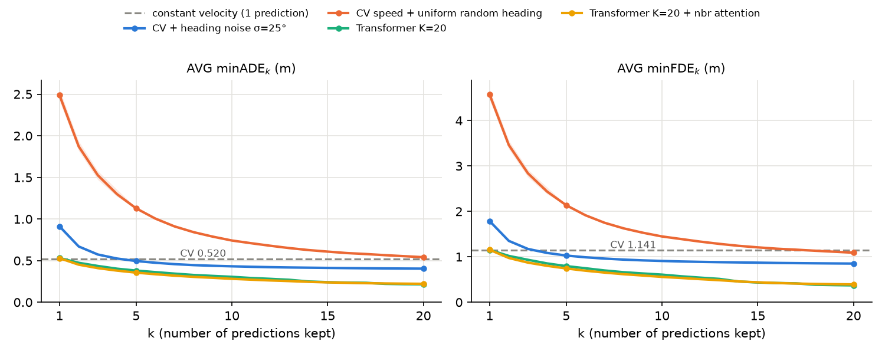
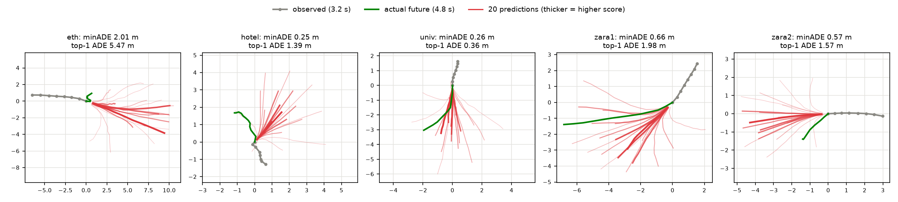

# D단계: 다중 예측(K=20)과 best-of-20

미래를 하나가 아니라 20개 내는 모델을 만들고, 논문들이 쓰는 minADE₂₀ / minFDE₂₀로 평가했다. 같은 지표로 "등속 + 잡음" 기준선도 쟀다. 모든 수치는 이 저장소에서 실제로 실행한 값이다. 논문 값은 원 논문 PDF의 표에서 옮겼다. 확인한 것과 추측은 나눠 적었다.

**결론**

- K=20 Transformer(heading, residual)는 AVG **minADE₂₀ / minFDE₂₀ = 0.216 ± 0.001 / 0.371 ± 0.006**이다. Social GAN 논문 값(20V-20: 0.58 / 1.18)보다 훨씬 낮다. Trajectron++ 논문 값(0.19 / 0.41)과는 ADE는 조금 높고 FDE는 조금 낮은 수준이다. 단, 논문들과 학습 · 평가 세부가 완전히 같지는 않다(4절).
- **best-of-K는 관대한 지표다.** 관측 방향을 버리고 방향을 무작위로 20번 뽑기만 해도 AVG minFDE₂₀가 1.090으로 결정적 등속 모델(1.141)보다 낮다. 방향에 25° 잡음만 준 등속 모델은 0.404 / 0.851로, 이 저장소의 어떤 단일 예측 모델보다도, Social GAN 논문 값보다도 낮다.
- 점수가 가장 높은 하나만 쓰면(k = 1) 0.531 / 1.152로 등속 모델(0.520 / 1.141) 수준이다. 20개 중 최선은 좋지만 "가장 그럴듯한 하나"를 고르는 능력은 단일 예측 모델(0.505 / 1.094)보다 못하다.
- 이웃 attention은 k = 5에서 도움이 되고(0.356 대 0.380), k = 20에서는 차이가 없거나 조금 나쁘다(0.221 대 0.216).
- 모드 붕괴는 없었다. 20개 모드 중 15~18개가 test 샘플의 1% 이상에서 winner가 된다.

```bash
.venv/bin/python -m unittest discover tests                                   # minADE / minFDE / top-k 테스트
.venv/bin/python scripts/eval_cv_sampling.py                                  # 등속 + 잡음 기준선 -> results/multimodal/cv_sampling.csv
for s in 0 1 2; do
  .venv/bin/python scripts/train_multimodal.py --modes 20 --residual --seed $s            # 이웃 없음
  .venv/bin/python scripts/train_multimodal.py --modes 20 --residual --social --seed $s   # 이웃 attention
done
.venv/bin/python scripts/summarize_multimodal.py > results/multimodal/summary_report.md   # 표, 모드 사용, 그림
```

## 1. 방법

### 1.1 지표 (`src/trajpred/metrics.py`)

- 샘플마다 K개 예측 중 실제와 가장 가까운 것의 오차를 쓴다. minADE_K = min_k ADE(예측 k, 실제), minFDE_K = min_k FDE(예측 k, 실제).
- Social GAN, Schöller et al.과 같이 **ADE와 FDE의 최솟값을 따로 고른다**. minADE를 주는 예측과 minFDE를 주는 예측이 다를 수 있다.
- `top_k`: 모드 점수가 높은 k개만 남긴다. 모델의 k < 20 값은 이것으로 잰다(k = 1 = 가장 그럴듯한 하나).
- 테스트(`tests/test_metrics.py`, 표준 라이브러리 `unittest`): 손으로 계산한 값, ADE · FDE를 따로 고르는지, K = 1이면 ADE/FDE와 같은지, K가 늘면 값이 커지지 않는지, top-k가 점수 순서대로 고르는지.

### 1.2 모델 (`src/trajpred/models/transformer.py`, `num_modes=20`)

- C단계의 Transformer(heading frame, residual)를 그대로 쓰고, 마지막 MLP 출력만 12 × 2에서 20 × 12 × 2로 늘렸다. 20개 모두 "등속 변위 + 보정량"이다.
- **모드 점수**: 작은 MLP가 h에서 20개 logit을 낸다. 입력은 `h.detach()`라서 점수 학습이 궤적 쪽 표현을 바꾸지 않는다.
- **손실 = winner-takes-all**: 샘플마다 20개 예측 각각의 MSE를 재고 가장 작은 것(winner)의 MSE만 줄인다. Social GAN의 variety loss와 같은 꼴이다. 모드 점수는 winner를 정답으로 하는 cross-entropy로 배운다.
- **초기화**: K = 1 residual 모델은 출력층을 0으로 두어 등속에서 출발했다. K = 20에서는 그렇게 하지 않았다. 20개가 모두 같은 예측에서 출발하면 늘 같은 모드만 winner가 되어 나머지가 학습되지 않기 때문이다.
- early stopping은 val minADE₂₀로 한다. 나머지 학습 설정(Adam 1e-3, 배치 64, patience 20, 회전 증강 없음)은 C단계와 같다.
- 파라미터 수: 이웃 없음 148,852개, 이웃 attention 166,132개. best 에폭 중앙값은 각각 42, 51로 K = 1 모델(13~30)보다 길다.

### 1.3 기준선: 등속 + 잡음 (`scripts/eval_cv_sampling.py`, 학습 없음)

마지막 관측 변위의 크기는 그대로 두고 방향만 돌려 20개를 만든다. 시드 0, 1, 2로 잡음을 뽑아 평균 ± 표준편차를 낸다.

| 이름 | 방향 잡음 |
| :--- | :--- |
| 등속 + 방향 잡음 σ=25° | N(0, 25°²). Schöller et al. 2020의 CVM-S(OUR-S)와 같은 설정이다. 논문 원문: "angular noise ... drawn from N(0, σ²) with σ = 25°" |
| 등속 + 방향 잡음 (σ train에서 고름) | 같은 꼴. σ를 0~60°(5° 간격) 중 각 분할의 **train** 데이터에서 minADE₂₀가 가장 작은 값으로 골랐다. eth · hotel · zara1 · zara2는 25°, univ는 15°가 골라졌다 |
| 등속 속력 + 무작위 방향 | 0~360° 균등. 관측 방향을 버리는 거의 무작위 예측이다 |

## 2. 결과 (시드 0, 1, 2)

### 2.1 장면별 minADE₂₀ / minFDE₂₀

m, 평균 ± 표본 표준편차. 등속(1개)은 비교용 결정적 예측이다.

| 장면 | 등속 (1개) | 등속 + 방향 잡음 σ=25° | 등속 속력 + 무작위 방향 | Transformer K=20 | Transformer K=20 + 이웃 attention |
| :--- | :-: | :-: | :-: | :-: | :-: |
| eth | 0.995 / 2.234 | 0.852 ± 0.003 / 1.884 ± 0.009 | 1.019 ± 0.004 / 2.144 ± 0.011 | **0.390 ± 0.005** / **0.621 ± 0.016** | 0.423 ± 0.006 / 0.741 ± 0.051 |
| hotel | 0.323 / 0.617 | 0.245 ± 0.001 / 0.458 ± 0.000 | 0.336 ± 0.004 / 0.633 ± 0.007 | **0.143 ± 0.004** / **0.231 ± 0.005** | 0.145 ± 0.004 / 0.236 ± 0.010 |
| univ | 0.524 / 1.165 | 0.387 ± 0.000 / 0.817 ± 0.000 | 0.468 ± 0.001 / 0.944 ± 0.002 | **0.220 ± 0.003** / **0.403 ± 0.007** | 0.223 ± 0.006 / 0.412 ± 0.013 |
| zara1 | 0.431 / 0.960 | 0.305 ± 0.001 / 0.617 ± 0.001 | 0.537 ± 0.007 / 1.036 ± 0.015 | 0.191 ± 0.001 / 0.355 ± 0.004 | **0.180 ± 0.001** / **0.329 ± 0.003** |
| zara2 | 0.326 / 0.729 | 0.229 ± 0.001 / 0.479 ± 0.002 | 0.346 ± 0.005 / 0.695 ± 0.009 | **0.134 ± 0.001** / 0.244 ± 0.003 | **0.134 ± 0.002** / **0.243 ± 0.004** |
| **AVG** | 0.520 / 1.141 | 0.404 ± 0.001 / 0.851 ± 0.002 | 0.541 ± 0.002 / 1.090 ± 0.005 | **0.216 ± 0.001** / **0.371 ± 0.006** | 0.221 ± 0.001 / 0.392 ± 0.011 |

"σ를 train에서 고른" 기준선은 AVG 0.405 ± 0.001 / 0.858 ± 0.002로 σ=25°와 거의 같다(univ만 다름). 전체 표는 `results/multimodal/summary_report.md`에 있다.

### 2.2 k에 따른 변화



| 방법 | k = 1 | k = 5 | k = 20 |
| :--- | :-: | :-: | :-: |
| 등속 (결정적) | 0.520 / 1.141 | — | — |
| 등속 + 방향 잡음 σ=25° | 0.911 ± 0.011 / 1.786 ± 0.016 | 0.495 ± 0.004 / 1.028 ± 0.003 | 0.404 ± 0.001 / 0.851 ± 0.002 |
| 등속 속력 + 무작위 방향 | 2.488 ± 0.067 / 4.571 ± 0.112 | 1.128 ± 0.009 / 2.136 ± 0.009 | 0.541 ± 0.002 / 1.090 ± 0.005 |
| Transformer K=20 | 0.531 ± 0.003 / 1.152 ± 0.004 | 0.380 ± 0.001 / 0.795 ± 0.002 | **0.216 ± 0.001** / **0.371 ± 0.006** |
| Transformer K=20 + 이웃 attention | 0.529 ± 0.006 / 1.154 ± 0.009 | **0.356 ± 0.010** / **0.743 ± 0.025** | 0.221 ± 0.001 / 0.392 ± 0.011 |

모델의 k < 20은 점수가 높은 k개, 기준선은 독립 샘플의 앞 k개다. 그림의 옅은 띠는 시드 3개의 최소~최대다.

- **무작위 방향 예측도 k가 커지면 좋아 보인다.** k = 1에서 2.488 / 4.571이던 것이 k = 20에서 0.541 / 1.090이 된다. FDE는 결정적 등속(1.141)보다 낮다. 관측 방향 정보를 전혀 쓰지 않는데도 그렇다.
- **σ=25° 잡음 등속은 k = 5부터 등속보다 낮다**(0.495 / 1.028). 하나만 내면(k = 1) 0.911 / 1.786으로 훨씬 나쁘다. 같은 예측기가 k에 따라 "가장 나쁜 모델"에서 "등속보다 좋은 모델"로 바뀐다.
- **학습한 모델은 모든 k에서 기준선보다 낮다.** k = 20에서 σ=25° 기준선의 약 절반이다(0.216 대 0.404). 차이가 기준선의 잡음 때문이 아니라는 뜻이다.
- **k = 1은 단일 예측 모델보다 못하다.** 이웃 attention K=20의 top-1은 0.529 / 1.154, 같은 구조의 K = 1 모델(C단계 6절)은 0.505 / 1.094다. winner-takes-all은 각 모드가 "자기가 맡은 미래"만 배우게 하므로, 평균적으로 가장 좋은 예측 하나를 내는 데는 불리하다(추측). 점수 MLP가 h를 detach한 작은 모델이라 winner를 잘 못 맞히는 것도 원인일 수 있다(추측, 확인 안 함).

### 2.3 이웃 attention은 언제 도움이 되나

- **k = 5에서는 이웃이 확실히 도움이 된다**(0.356 ± 0.010 대 0.380 ± 0.001, FDE 0.743 대 0.795).
- **k = 20에서는 이웃 없는 모델이 같거나 조금 낫다**(0.216 대 0.221, FDE 0.371 대 0.392). 장면별로는 zara1에서 이웃이 낫고(0.180 대 0.191), eth에서 나쁘다(0.423 대 0.390).
- 해석(추측): 20개면 이웃 없이도 갈 수 있는 방향을 거의 다 덮는다. 이웃 정보는 "어느 쪽이 더 그럴듯한가"를 정해 적은 수의 예측을 잘 배치하는 데 쓰인다. C단계에서 이웃 attention이 단일 예측 FDE를 크게 줄인 것과 같은 방향이다.

### 2.4 모드 사용과 예시

`summarize_multimodal.py`가 test 샘플마다 minADE 모드(winner)를 세었다.

| 모델 | winner 비율 1% 이상인 모드 수 (장면 5개 평균) | 가장 많이 이긴 모드의 비율 |
| :--- | --: | --: |
| Transformer K=20 (시드 0 / 1 / 2) | 15.8 / 15.6 / 15.0 | 0.293 / 0.296 / 0.307 |
| + 이웃 attention (시드 0 / 1 / 2) | 17.8 / 17.2 / 17.4 | 0.311 / 0.286 / 0.293 |

- 모드 하나가 대부분을 차지하는 붕괴는 없다. 가장 많이 이기는 모드는 약 30%다(주로 정지 · 직진으로 보인다. 확인하지 않았다).



장면마다 관측 속력 0.5 m/s 이상이고 실제 미래가 관측 방향에서 30° 넘게 꺾는 샘플을 하나 무작위로 골랐다(이웃 attention, 시드 0). 선이 굵고 진할수록 모드 점수가 높다. 어려운 샘플만 골랐으므로 오차가 평균보다 크다.

- 예측 20개는 관측 방향을 중심으로 부채꼴로 퍼진다. univ · hotel 예처럼 실제 경로가 부채꼴 안에 있으면 minADE가 작다(0.26, 0.25 m).
- 점수가 높은 모드는 대체로 직진에 가깝다. 실제로 꺾은 샘플에서는 top-1 ADE가 크다(zara1 1.98 m, eth 5.47 m).

## 3. 논문 표와 비교

원 논문 PDF의 표에서 직접 옮겼다(Social GAN arXiv 1803.10892 v1, Trajectron++ arXiv 2001.03093 v5, Schöller et al. arXiv 1903.07933 v3). ADE / FDE (m), 예측 12스텝(4.8 s).

| 방법 (출처) | K | eth | hotel | univ | zara1 | zara2 | AVG |
| :--- | :-: | :-: | :-: | :-: | :-: | :-: | :-: |
| Social GAN 20V-20 (Gupta et al. 2018, Table 1) | 20 | 0.81 / 1.52 | 0.72 / 1.61 | 0.60 / 1.26 | 0.34 / 0.69 | 0.42 / 0.84 | 0.58 / 1.18 |
| Social GAN 20VP-20 (같은 표) | 20 | 0.87 / 1.62 | 0.67 / 1.37 | 0.76 / 1.52 | 0.35 / 0.68 | 0.42 / 0.84 | 0.61 / 1.21 |
| Trajectron++ Full (Salzmann et al. 2020, Table 2b) | 20 | 0.39 / 0.83 | 0.12 / 0.21 | 0.20 / 0.44 | 0.15 / 0.33 | 0.11 / 0.25 | 0.19 / 0.41 |
| CVM-S, OUR-S (Schöller et al. 2020, Table I) | 20 | 0.43 / 0.80 | 0.19 / 0.35 | 0.34 / 0.71 | 0.24 / 0.48 | 0.21 / 0.45 | 0.28 / 0.56 |
| **이 저장소** 등속 + 방향 잡음 σ=25° | 20 | 0.852 / 1.884 | 0.245 / 0.458 | 0.387 / 0.817 | 0.305 / 0.617 | 0.229 / 0.479 | 0.404 / 0.851 |
| **이 저장소** Transformer K=20 | 20 | 0.390 / 0.621 | 0.143 / 0.231 | 0.220 / 0.403 | 0.191 / 0.355 | 0.134 / 0.244 | 0.216 / 0.371 |
| Trajectron++ ML (같은 논문, Table 2a) | 1 | 0.71 / 1.66 | 0.22 / 0.46 | 0.44 / 1.17 | 0.30 / 0.79 | 0.23 / 0.59 | 0.38 / 0.93 |
| **이 저장소** Transformer + 이웃 attention + residual (C단계) | 1 | 0.891 / 1.969 | 0.337 / 0.647 | 0.529 / 1.162 | 0.429 / 0.943 | 0.337 / 0.749 | 0.505 / 1.094 |

**평가 프로토콜 차이** (논문 본문에서 확인한 것)

- **샘플 규칙**: 이 저장소의 샘플은 Social-GAN 데이터 로더와 같다(README "데이터셋 클래스" 절에서 직접 비교). 그래서 Social GAN 표와는 test 샘플이 같다. Social GAN 논문 자체는 윈도우 규칙을 적지 않고 "[1](Social LSTM)과 비슷한 평가 방법"이라고만 적었다. Trajectron++는 8 → 12스텝, leave-one-out이라고만 적었다.
- **Schöller et al.는 샘플 규칙이 다르다**: 한 칸씩 밀어 길이 20으로 자르되, "길이가 10보다 짧은 것만 버린다". 미래가 12스텝보다 짧은 샘플이 섞이므로 오차가 작게 나온다. 그 논문의 결정적 등속(0.39 / 0.83)과 이 저장소의 등속(0.520 / 1.141)의 차이도 여기서 온다(README "논문 수치와 비교"). 같은 σ=25° 기준선이 이 저장소에서 0.404 / 0.851로 큰 것도 같은 이유다.
- **best-of-K 방식**: 세 논문 모두 20개 중 L2 기준 최선을 쓴다. Schöller et al.는 "minimum ADE and FDE"를 쓴다고 적었다. 이 저장소도 ADE와 FDE의 최솟값을 따로 고른다.
- **증강**: Trajectron++는 장면 전체를 15° 간격(0~345°)으로 돌려 학습 데이터를 늘렸다(Appendix D.3). 이 저장소의 K=20 모델은 회전 증강 없이 heading frame으로 회전 문제를 푼다.
- Trajectron++ Table 2b의 "S-GAN" 열은 Social GAN Table 1의 20V-20 열(pooling 없음)과 같은 값이다.

**해석**

- 이 저장소의 K=20 Transformer는 같은 샘플 규칙의 Social GAN 논문 값보다 ADE · FDE 모두 훨씬 낮다(0.216 / 0.371 대 0.58 / 1.18). 그러나 **등속 + 방향 잡음 기준선도 Social GAN 논문 값보다 낮다**(0.404 / 0.851). Social GAN 논문 값은 이후 공개 코드 · 모델보다 낮은 성능이라는 지적이 있다(Schöller et al. IV절: 공개된 모델이 "논문에 보고한 것보다 개선된 버전"). 따라서 "Social GAN을 이겼다"보다 "2018년 논문 표의 값이 지금 기준으로는 약하다"로 읽는 것이 맞다.
- Trajectron++와는 장면마다 엇갈린다. ADE는 eth가 같고(0.39 대 0.390) 나머지 4개 장면은 Trajectron++가 낮다. FDE는 eth · univ · zara2에서 이 저장소가 낮고, hotel · zara1은 Trajectron++가 낮다. AVG로는 ADE 0.216 대 0.19, FDE 0.371 대 0.41이다. 학습 설정(에폭, 증강, 입력)이 달라 이 차이로 어느 쪽이 낫다고 말하기는 어렵다.
- 단일 예측(K = 1)으로는 Trajectron++ ML(0.38 / 0.93)이 이 저장소의 최선(0.505 / 1.094)보다 훨씬 낮다. 두 논문이 같은 데이터를 쓰는지는 Trajectron++ 본문으로 확인할 수 없었다.

## 4. 정리

**확인한 것**

1. minADE / minFDE 평가 코드와 테스트를 만들었다(5개 테스트 통과).
2. K=20 Transformer(heading, residual)는 AVG 0.216 ± 0.001 / 0.371 ± 0.006, 이웃 attention을 더하면 0.221 ± 0.001 / 0.392 ± 0.011이다.
3. best-of-20은 관대하다. 관측 방향을 버린 무작위 방향 예측도 FDE가 결정적 등속보다 낮아지고(1.090 대 1.141), σ=25° 잡음 등속은 Social GAN 논문 값보다 낮다.
4. 이웃 attention은 k = 5에서 도움이 되고(0.356 대 0.380), k = 20에서는 아니다.
5. 점수 1위 하나(k = 1)는 0.529~0.531 / 1.152~1.154로, 단일 예측 전용 모델(0.505 / 1.094)보다 나쁘다.
6. 모드 붕괴는 없었다(1% 이상 이기는 모드 15~18개, 최다 모드 약 30%).

**추측(확인하지 않음)**

- k = 1이 나쁜 것은 winner-takes-all이 "평균적으로 최선"을 배우지 않기 때문이고, 점수 MLP가 작고 h를 detach해서 winner를 잘 못 맞히기 때문일 수 있다.
- 이웃 정보는 갈 수 있는 경로의 "범위"보다 "순위"를 바꾼다. 그래서 k가 작을 때만 도움이 된다.
- best-of-K만으로는 예측 분포의 질을 판단할 수 없다. 확률까지 평가하는 지표(Trajectron++의 KDE NLL 등)나 k = 1 지표를 같이 보고해야 한다. 이 저장소에서는 NLL을 재지 않았다.
