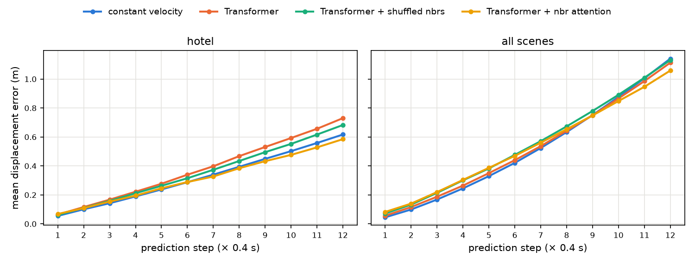
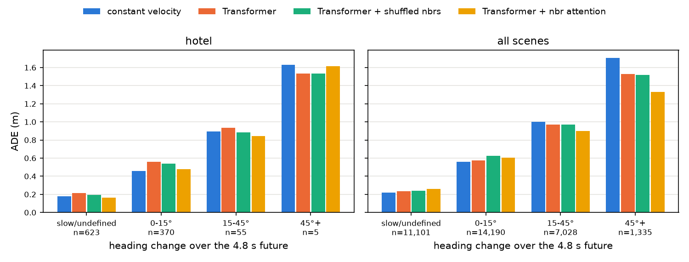
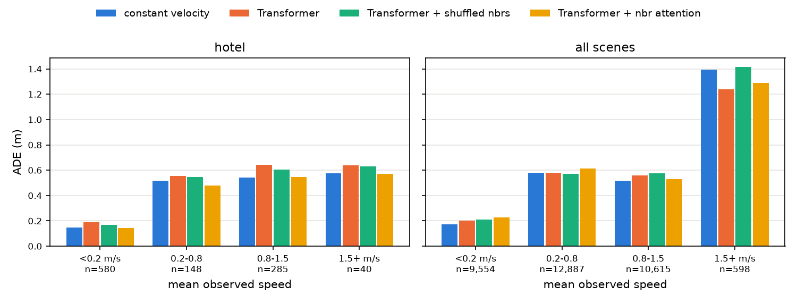
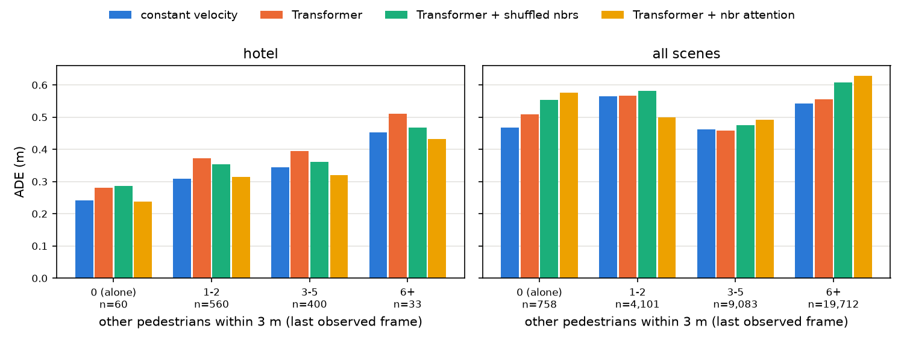
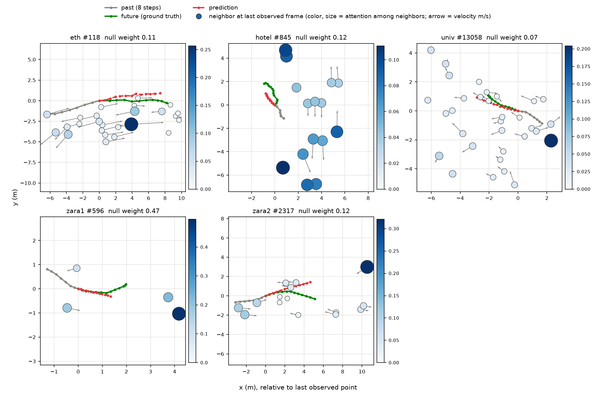

# C단계: Transformer와 이웃 attention

시간축 self-attention 인코더와 non-autoregressive 디코더로 Transformer를 만들었다. 대상 보행자가 이웃들에게 cross-attention하는 버전도 만들었다. 기본 설정은 heading frame(회전 증강 없음)이다. 모든 수치는 이 저장소에서 실제로 실행한 값이다. 확인한 것과 추측은 나눠 적었다.

**결론**

- 이웃 attention Transformer는 **AVG FDE 1.059 ± 0.005로 이 저장소의 모든 모델 중 가장 좋고, 등속 모델(1.141)보다 확실히 낮다.** hotel도 ADE 0.333 ± 0.015로 등속(0.323)에 거의 붙었다.
- A · B단계에서 개선되지 않던 **15° 이상 꺾는 샘플이 크게 좋아졌다**(all scenes 15–45°: 0.972 → 0.901, 45°+: 1.556 → 1.398).
- 섞은 이웃으로는 이 개선이 대부분 나오지 않는다. 지문이 아니라 진짜 이웃 정보를 쓴다.
- 대가도 있다. 첫 스텝 오차와 정지 · 저속 보행자 오차가 커져서 AVG ADE는 0.537로 이웃 없는 Transformer(0.529)보다 나쁘다. univ(붐비는 장면)에서도 나빠졌다.
- attention 가중치는 "가까운 · 다가오는 이웃"을 특별히 보지 않았다. 가장 많이 본 이웃이 가장 가까운 이웃인 비율은 무작위 수준이었고, 먼 이웃일수록 가중치가 조금 컸다.

```bash
.venv/bin/python scripts/train_lstm.py --model transformer --frame heading --seed 0                 # 이웃 없음
.venv/bin/python scripts/train_lstm.py --model transformer --frame heading --social --seed 0        # 이웃 attention
.venv/bin/python scripts/train_lstm.py --model transformer --frame heading --social \
    --neighbor-control shuffle --tag shuffle --seed 0                                                 # 섞은 이웃 (대조)
for s in 0 1 2; do
  .venv/bin/python scripts/analyze_errors.py --tag C_seed$s --runs tf_none_heading_seed$s \
      tf_none_heading_social_shuffle_seed$s tf_none_heading_social_seed$s > results/analysis/C_seed${s}_report.md
done
.venv/bin/python scripts/compare_bins.py --tags C_seed0 C_seed1 C_seed2 --out-tag C \
    --conditions tf_none_heading tf_none_heading_social_shuffle tf_none_heading_social
.venv/bin/python scripts/analyze_attention.py --runs tf_none_heading_social_seed{0,1,2} \
    tf_none_heading_social_shuffle_seed{0,1,2} > results/analysis/C_attention_report.md
```

## 1. 모델 (`src/trajpred/models/transformer.py`)

**시간축 인코더**

- 토큰 7개(t = 1..7)마다 [변위 obs[t] − obs[t−1], 위치 obs[t] − obs[−1]](4차원)를 `Linear`로 64차원에 올리고, 시점마다 하나씩 학습하는 위치 임베딩을 더한다.
- `TransformerEncoder`(2층, 4 head, FFN 128, dropout 0.1)가 7개 토큰 전체를 서로 보게 한다. 모두 과거라 causal mask는 쓰지 않았다.
- 마지막 토큰(t = 7)의 출력을 대상 보행자 요약 h로 쓴다.

**non-autoregressive 디코더**

- h → MLP(64 → 128 → 24)로 12스텝 변위를 **한 번에** 내고, 누적합으로 위치를 만든다. LSTM처럼 자기 예측을 다시 넣지 않는다.

**이웃 cross-attention** (`--social`)

- 이웃 토큰은 마지막 관측 프레임의 이웃마다 [상대 위치, 속도, 상대 속도](6차원) → `Linear` → 64차원이다. B단계와 같은 이웃 데이터(같은 프레임의 모든 보행자, 가까운 32명)를 쓴다.
- query = h, key/value = [null 토큰, 이웃 토큰들]로 `MultiheadAttention`(4 head)을 한 번 한다. 결과를 h에 더하고 LayerNorm한 뒤 같은 MLP로 예측한다.
- **null 토큰**: 학습하는 벡터 하나를 항상 key 목록 맨 앞에 둔다. 이웃이 0명이어도 attention할 곳이 있고(softmax가 정의됨), null에 준 가중치를 "이웃을 안 보는 정도"로 읽을 수 있다.
- 없는 이웃(빈 칸)은 `key_padding_mask`로 가린다. 이웃 수가 샘플마다 달라도 된다.

**코드로 확인한 성질**: 입력과 이웃을 함께 돌리면 예측도 같이 돈다(회전 등변성). attention 가중치의 합은 1이다. 이웃 0명 샘플은 null에 1.0을 준다. 가려진 이웃의 가중치는 0이다. 이웃 순서를 바꿔도 예측이 같다(집합 연산).

파라미터 수는 이웃 없음 79,128개, 이웃 attention 96,408개다. LSTM(199,106개)의 절반 이하다.

## 2. 결과 (시드 0, 1, 2)

ADE / FDE (m), 평균 ± 표본 표준편차. 전체 조건 표는 README에 있다.

| 장면 | 등속 | LSTM heading | Transformer | + 섞은 이웃 (대조) | + 이웃 attention |
| :--- | :-: | :-: | :-: | :-: | :-: |
| eth | 0.995 / 2.234 | 0.951 / 1.901 | 0.944 ± 0.023 / 1.928 ± 0.045 | 1.023 ± 0.093 / 1.960 ± 0.107 | 0.985 ± 0.029 / **1.722 ± 0.056** |
| hotel | **0.323** / **0.617** | 0.387 / 0.749 | 0.366 ± 0.012 / 0.711 ± 0.016 | 0.362 ± 0.024 / 0.694 ± 0.048 | 0.333 ± 0.015 / 0.620 ± 0.031 |
| univ | 0.524 / 1.165 | 0.517 / 1.129 | 0.529 ± 0.004 / 1.145 ± 0.008 | 0.538 ± 0.010 / 1.158 ± 0.023 | 0.572 ± 0.030 / 1.223 ± 0.073 |
| zara1 | **0.431** / 0.960 | 0.456 / 1.032 | 0.459 ± 0.005 / 1.024 ± 0.011 | 0.440 ± 0.006 / 0.983 ± 0.012 | 0.443 ± 0.002 / **0.954 ± 0.006** |
| zara2 | **0.326** / **0.729** | 0.346 / 0.751 | 0.346 ± 0.012 / 0.778 ± 0.024 | 0.352 ± 0.009 / 0.773 ± 0.021 | 0.354 ± 0.005 / 0.779 ± 0.024 |
| **AVG** | **0.520** / 1.141 | 0.531 / 1.112 | 0.529 ± 0.005 / 1.117 ± 0.010 | 0.543 ± 0.014 / 1.114 ± 0.016 | 0.537 ± 0.003 / **1.059 ± 0.005** |

(LSTM heading의 표준편차는 README 표 참고)

- **이웃 없는 Transformer는 LSTM heading과 같은 수준이다**(AVG 0.529 / 1.117 대 0.531 / 1.112). 파라미터는 절반 이하다.
- **이웃 attention은 FDE를 크게 줄인다.** AVG FDE 1.059 ± 0.005는 등속(1.141)보다 0.08 낮고, 시드 편차의 10배가 넘는다. eth(1.722)와 zara1(0.954)은 등속보다 낮고, hotel(0.620)은 등속(0.617)과 같다. univ는 나빠졌다(1.223 ± 0.073).
- **ADE는 오히려 나빠졌다**(0.537 ± 0.003 대 0.529 ± 0.005). 3절에서 보듯 앞쪽 스텝과 정지 · 저속 샘플에서 잃기 때문이다.
- **hotel**: 이웃 attention의 ADE 0.333 ± 0.015는 지금까지 가장 등속(0.323)에 가깝다. 시드 0은 0.316으로 등속보다 낮지만, 시드 1, 2는 0.340, 0.342다. 평균으로는 아직 등속을 넘지 못했다.
- **섞은 이웃(대조)**: AVG FDE 1.114 ± 0.016으로 이웃 없는 모델(1.117)과 같다. 이웃 attention의 FDE 개선(1.059)은 지문이 아니라 진짜 이웃 정보에서 온다. hotel에서는 섞은 이웃도 조금 낫다(0.362 대 0.366, 편차 안).
- **early stopping 에폭**: best 에폭 중앙값은 이웃 없음 30, 이웃 attention 13, 섞은 이웃 22다. 이웃 attention이 더 일찍 val 최저점에 닿지만, B단계 grid pooling(중앙값 9)처럼 val이 처음부터 나빠지지는 않았다. 시드 0의 val ADE 평균은 0.4395(이웃 없음), 0.4396(이웃 attention), 0.4423(섞은 이웃)이다.

### 2.1 크기 · 학습 시간 · 성능 한눈에

| 모델 | 파라미터 | 에폭당 시간 | best 에폭 중앙값 | AVG ADE | AVG FDE |
| :--- | --: | --: | --: | :-: | :-: |
| 등속 | 0 | — | — | **0.520** | 1.141 |
| LSTM heading + 회전 증강 | 199,106 | 2.6 s | 27 | 0.543 ± 0.014 | 1.129 ± 0.020 |
| LSTM + grid pooling (4×4, dropout 0.5) | 235,010 | 2.4 s | 9 | 0.531 ± 0.002 | 1.107 ± 0.009 |
| Transformer | 79,128 | 1.7 s | 30 | 0.529 ± 0.005 | 1.117 ± 0.010 |
| Transformer + 이웃 attention | 96,408 | 2.2 s | 13 | 0.537 ± 0.003 | **1.059 ± 0.005** |

에폭당 시간은 학습 로그의 평균이다. 2~3개 실행을 한 GPU에서 동시에 돌린 값이라 혼자 돌릴 때보다 느리고, 모델 간 대략적인 비교로만 읽는다. best 에폭은 시드 3개 × 5개 분할의 중앙값이다.

## 3. A단계 기준으로 다시 나눠 보기

시드 3개 각각 오차 분해하고 묶음별 평균 ± 표준편차를 냈다(`results/analysis/C_bins_seeds.csv`). 그림은 시드 0이다. "차이"는 이웃 attention − 이웃 없음이다.

### 3.1 스텝별: 앞쪽은 나빠지고 뒤쪽은 좋아진다



| | 모델 | step 1 | step 4 | step 8 | step 12 | ADE |
| :--- | :--- | --: | --: | --: | --: | --: |
| all scenes | 등속 | **0.045** | **0.245** | **0.634** | 1.141 | **0.520** |
| | Transformer | 0.056 | 0.264 | 0.643 | 1.113 | 0.526 |
| | + 섞은 이웃 | 0.072 | 0.300 | 0.673 | 1.131 | 0.553 |
| | + 이웃 attention | 0.082 | 0.304 | 0.654 | **1.059** | 0.535 |
| hotel | 등속 | **0.055** | 0.189 | 0.394 | 0.617 | 0.323 |
| | Transformer | 0.064 | 0.222 | 0.468 | 0.730 | 0.380 |
| | + 섞은 이웃 | 0.061 | 0.211 | 0.434 | 0.683 | 0.356 |
| | + 이웃 attention | 0.068 | 0.195 | **0.384** | **0.585** | **0.316** |

(시드 0)

- 이웃 attention은 첫 스텝 오차가 0.082로 등속(0.045)의 두 배 가깝다. 12스텝을 한 번에 내는 디코더가 첫 스텝을 "마지막 변위를 한 번 더"처럼 정확히 맞히지 못한다. 그 대신 뒤쪽 스텝에서 크게 좋아져 step 12는 모든 모델 중 가장 낮다.
- 시드 0 hotel에서는 step 4부터 등속을 따라잡아 ADE 0.316으로 등속보다 낮다.

### 3.2 방향 전환 각도별: 꺾는 샘플이 크게 좋아졌다



| | 각도 | n | 등속 | Transformer | + 섞은 이웃 | + 이웃 attention | 차이 |
| :--- | :--- | --: | --: | --: | --: | --: | --: |
| all scenes | slow/undefined | 11,101 | **0.218** | 0.229 ± 0.012 | 0.240 ± 0.008 | 0.266 ± 0.011 | +0.037 |
| | 0–15° | 14,190 | **0.561** | 0.586 ± 0.008 | 0.614 ± 0.030 | 0.602 ± 0.003 | +0.016 |
| | 15–45° | 7,028 | 1.003 | 0.972 ± 0.002 | 0.954 ± 0.016 | **0.901 ± 0.024** | **−0.071** |
| | 45°+ | 1,335 | 1.705 | 1.556 ± 0.026 | 1.494 ± 0.025 | **1.398 ± 0.063** | **−0.158** |
| hotel | slow/undefined | 623 | **0.180** | 0.180 ± 0.032 | 0.208 ± 0.033 | 0.197 ± 0.030 | +0.017 |
| | 0–15° | 370 | **0.460** | 0.577 ± 0.020 | 0.530 ± 0.016 | 0.473 ± 0.014 | −0.104 |
| | 15–45° | 55 | 0.896 | 0.957 ± 0.024 | 0.866 ± 0.024 | **0.820 ± 0.024** | −0.137 |
| | 45°+ | 5 | 1.629 | 1.551 ± 0.034 | 1.533 ± 0.047 | 1.556 ± 0.055 | +0.005 |

- **15° 이상 꺾는 샘플에서 이웃 attention이 확실히 좋아졌다.** all scenes 15–45°는 −0.071(시드 편차 0.002~0.024의 3배 이상), 45°+는 −0.158이다. B단계 grid pooling에서는 이 칸들이 시드 편차 안이었다.
- 섞은 이웃도 꺾는 샘플에서 조금 좋아진다(15–45° 0.954, 45°+ 1.494). 진짜 이웃은 그보다 더 좋다(0.901, 1.398).
- 손해는 정지 · 저속(+0.037)과 직진(+0.016)에서 본다.
- hotel은 직진(0–15°)에서도 크게 좋아졌다(0.577 → 0.473, 등속 0.460에 근접).

### 3.3 관측 속력별



| | 속력 | n | 등속 | Transformer | + 섞은 이웃 | + 이웃 attention | 차이 |
| :--- | :--- | --: | --: | --: | --: | --: | --: |
| all scenes | < 0.2 m/s | 9,554 | **0.174** | 0.196 ± 0.012 | 0.210 ± 0.005 | 0.236 ± 0.012 | +0.040 |
| | 0.2–0.8 | 12,887 | 0.581 | 0.586 ± 0.005 | **0.579 ± 0.017** | 0.602 ± 0.013 | +0.016 |
| | 0.8–1.5 | 10,615 | **0.519** | 0.561 ± 0.004 | 0.561 ± 0.013 | 0.520 ± 0.011 | −0.041 |
| | 1.5+ m/s | 598 | 1.393 | **1.267 ± 0.028** | 1.366 ± 0.158 | 1.333 ± 0.065 | +0.066 |
| hotel | < 0.2 m/s | 580 | **0.148** | 0.154 ± 0.031 | 0.182 ± 0.029 | 0.176 ± 0.029 | +0.022 |
| | 0.2–0.8 | 148 | 0.516 | 0.558 ± 0.008 | 0.554 ± 0.031 | **0.504 ± 0.028** | −0.054 |
| | 0.8–1.5 | 285 | 0.541 | 0.657 ± 0.018 | 0.593 ± 0.020 | **0.531 ± 0.021** | −0.126 |
| | 1.5+ m/s | 40 | 0.577 | 0.660 ± 0.027 | 0.611 ± 0.023 | **0.562 ± 0.013** | −0.098 |

- hotel에서는 0.2 m/s 이상 모든 구간에서 이웃 attention이 등속보다 낮다. A단계에서 찾은 hotel의 남은 차이(정지 보행자, 걷는 보행자 속도 줄이기) 중 걷는 보행자 쪽이 사라졌다.
- 정지 · 저속(< 0.2 m/s)은 all scenes, hotel 모두 나빠졌다. 이웃이 움직이면 서 있는 사람도 움직이게 예측하는 경향으로 보인다(추측).

### 3.4 이웃 수별



| | 이웃 수 (3 m 안) | n | 등속 | Transformer | + 섞은 이웃 | + 이웃 attention | 차이 |
| :--- | :--- | --: | --: | --: | --: | --: | --: |
| all scenes | 0 (혼자) | 758 | **0.468** | 0.514 ± 0.007 | 0.545 ± 0.015 | 0.591 ± 0.045 | +0.077 |
| | 1–2 | 4,101 | 0.564 | 0.567 ± 0.002 | 0.572 ± 0.011 | **0.523 ± 0.020** | −0.043 |
| | 3–5 | 9,083 | 0.462 | **0.461 ± 0.005** | 0.470 ± 0.013 | 0.482 ± 0.010 | +0.021 |
| | 6+ | 19,712 | **0.543** | 0.564 ± 0.011 | 0.594 ± 0.038 | 0.613 ± 0.013 | +0.049 |
| hotel | 0 (혼자) | 60 | **0.242** | 0.258 ± 0.020 | 0.286 ± 0.012 | 0.279 ± 0.036 | +0.021 |
| | 1–2 | 560 | 0.308 | 0.362 ± 0.009 | 0.359 ± 0.024 | 0.333 ± 0.016 | −0.029 |
| | 3–5 | 400 | 0.344 | 0.379 ± 0.014 | 0.369 ± 0.027 | **0.330 ± 0.008** | −0.050 |
| | 6+ | 33 | **0.452** | 0.479 ± 0.033 | 0.471 ± 0.018 | 0.470 ± 0.034 | −0.009 |

- 3 m 안에 이웃이 **1–2명**일 때 가장 좋아지고(all scenes −0.043), **혼자**(+0.077)와 **6명 이상**(+0.049)일 때 나빠진다.
- 혼자인 샘플이 나빠지는 것은 이웃 정보에 기대도록 학습된 모델이 이웃이 없을 때 오히려 헤매는 것으로 보인다. 4.2의 "이웃 모두 지우기"에서 크게 나빠지는 것과 같은 방향이다.
- 6명 이상 칸은 개수로는 대부분 univ 샘플이다(univ test의 74%가 이 칸이다. 장면 동일 비중 가중치로는 약 58%). B단계와 마찬가지로 univ 분할의 학습 데이터는 한산하다(3 m 안 평균 3.3명, test는 8.6명).

## 4. attention이 실제로 무엇을 보나

### 4.1 attention 가중치 통계

`scripts/analyze_attention.py`. 이웃이 2명 이상인 샘플만 쓴다. all scenes는 장면별 값의 단순 평균이다.

| 모델 | null 가중치 | top = nearest | 무작위 기대값 |
| :--- | --: | --: | --: |
| 이웃 attention 시드 0 | 0.207 | 0.110 | 0.131 |
| 이웃 attention 시드 1 | 0.206 | 0.132 | 0.131 |
| 이웃 attention 시드 2 | 0.244 | 0.114 | 0.131 |
| 섞은 이웃 시드 0 | 0.207 | 0.086 | 0.131 |
| 섞은 이웃 시드 1 | 0.173 | 0.080 | 0.131 |
| 섞은 이웃 시드 2 | 0.263 | 0.070 | 0.131 |

"top = nearest"는 가중치가 가장 큰 이웃이 가장 가까운 이웃인 비율이다. "무작위 기대값"은 이웃 중 하나를 무작위로 고를 때의 기대값(1 / 이웃 수의 평균)이다.

이웃 한 명당 상대 가중치(null을 뺀 이웃들끼리 정규화한 가중치 × 그 샘플의 이웃 수. 균등하게 나누면 1)를 거리, 다가옴/멀어짐(closing speed > 0.1 m/s / < −0.1 m/s), 앞/뒤(진행 방향 쪽인지)로 나눴다.

| 모델 | < 1 m | 1–2 m | 2–4 m | 4 m+ | 다가옴 | 멀어짐 | 앞 | 뒤 |
| :--- | --: | --: | --: | --: | --: | --: | --: | --: |
| 이웃 attention 시드 0 | 0.86 | 0.84 | 0.93 | 1.08 | 1.02 | 1.00 | 1.06 | 0.95 |
| 이웃 attention 시드 1 | 0.89 | 0.85 | 0.93 | 1.07 | 1.00 | 1.01 | 1.02 | 1.00 |
| 이웃 attention 시드 2 | 0.82 | 0.82 | 0.92 | 1.10 | 1.03 | 1.00 | 1.07 | 0.92 |
| 섞은 이웃 시드 0 | 0.78 | 0.84 | 0.93 | 1.09 | 1.03 | 1.00 | 1.04 | 0.97 |
| 섞은 이웃 시드 1 | 0.79 | 0.86 | 0.94 | 1.09 | 0.94 | 1.13 | 0.93 | 1.07 |
| 섞은 이웃 시드 2 | 0.65 | 0.78 | 0.93 | 1.13 | 1.04 | 1.03 | 1.06 | 0.95 |

- **가까운 이웃을 특별히 보지 않는다.** 가장 많이 본 이웃이 가장 가까운 이웃인 비율(0.110~0.132)은 무작위(0.131)와 같다. 이웃 한 명당 가중치는 오히려 4 m 넘는 이웃이 조금 크다(1.07~1.10).
- **다가오는 이웃도 특별히 보지 않는다**(1.00~1.03 대 1.00~1.01).
- 진행 방향 앞쪽 이웃은 조금 더 본다(시드 0, 2: 1.06, 1.07 대 0.95, 0.92). 시드 1은 거의 차이가 없다(1.02 대 1.00).
- 섞은 이웃 모델도 거리에 따른 가중치 패턴이 비슷하다. 가중치 패턴만으로는 진짜 이웃과 섞은 이웃을 구분하기 어렵다.

예시(시드 0, 15° 이상 꺾고 4 m 안에 이웃 3명 이상인 샘플을 장면마다 무작위로 하나씩):



점의 색과 크기는 이웃들 사이의 attention 비중이고, 화살표는 이웃의 속도(m/s)다. 가장 많이 본 이웃이 4~10 m 떨어진 경우가 많다. 그림 하나의 색 막대는 패널마다 따로다.

섞은 이웃 모델의 같은 그림은 `figures/C_attention_tf_none_heading_social_shuffle_seed0.png`에 있다.

### 4.2 이웃 지우기 시험: 가중치 대신 실제 의존도

attention 가중치가 크다고 그 입력이 예측에 중요하다는 보장은 없다. 그래서 평가 때만 마지막 관측 프레임의 이웃 일부를 가리고(mask) 오차가 얼마나 변하는지 쟀다. 시드 3개의 평균이다. 학습 때 본 적 없는 이웃 분포가 되므로 대략적인 의존도로만 읽는다.

| 조건 | hotel ADE / FDE | all scenes ADE / FDE |
| :--- | --: | --: |
| 이웃 그대로 | 0.333 / 0.620 | 0.537 / 1.060 |
| 2 m 안 이웃 지움 | 0.342 / 0.638 | 0.549 / 1.081 |
| 2–4 m 이웃 지움 | 0.340 / 0.636 | 0.542 / 1.071 |
| 4 m 넘는 이웃 지움 | 0.331 / 0.619 | 0.548 / 1.107 |
| 이웃 모두 지움 | 0.396 / 0.760 | 0.622 / 1.284 |
| 위치는 두고 속도만 0 | 0.348 / 0.669 | 0.533 / 1.093 |

샘플 1개당 마지막 관측 프레임의 이웃 수(평균): 2 m 안 1.2~4.6명, 2–4 m 1.6~8.7명, 4 m 넘게 3.5~17.9명(장면에 따라).

- **이웃 모두 지우면 크게 나빠진다**(all scenes FDE 1.060 → 1.284). 이웃 없는 Transformer(1.117)보다도 나쁘다. 모델이 이웃 정보에 의존하도록 학습됐다.
- **all scenes에서는 4 m 넘는 이웃을 지울 때 FDE가 가장 많이 나빠진다**(+0.047). 2 m 안을 지우면 +0.021이다. 4 m 넘는 이웃은 2 m 안 이웃보다 수가 2~4배 많아서, 한 명당 영향은 가까운 이웃이 더 클 수 있다. 이 시험으로는 구분하지 않았다.
- **hotel에서는 4 m 넘는 이웃을 지워도 거의 변화가 없다**(0.620 → 0.619). 2 m 안(+0.018)과 2–4 m(+0.016)가 영향을 준다. 장면에 따라 쓰는 이웃이 다르다.
- 속도만 지워도 FDE가 나빠지지만(+0.033) 이웃을 모두 지울 때(+0.224)보다 훨씬 작다. 이웃의 **위치**가 정보의 대부분을 나른다.

## 5. 정리

**확인한 것**

1. 이웃 attention Transformer는 AVG FDE 1.059 ± 0.005로 지금까지 가장 좋고, 등속 모델(1.141)보다 확실히 낮다. AVG ADE는 0.537 ± 0.003으로 등속(0.520)보다 여전히 높다.
2. 15° 이상 꺾는 샘플에서 크게 좋아졌다(15–45° −0.071, 45°+ −0.158, 시드 편차보다 큼). B단계 grid pooling에서는 이 개선이 없었다.
3. 섞은 이웃 대조군은 AVG FDE가 이웃 없는 모델과 같다(1.114 대 1.117). 개선은 진짜 이웃 정보에서 온다.
4. 손해는 앞쪽 스텝(step 1: 0.082 대 등속 0.045), 정지 · 저속(+0.040), 혼자인 샘플(+0.077), 6명 이상(+0.049, 주로 univ)에서 본다.
5. hotel은 ADE 0.333 ± 0.015로 등속(0.323)에 가장 가까워졌다. 0.2 m/s 이상으로 걷는 보행자는 모든 속력 구간에서 등속보다 낮다.
6. attention 가중치는 가까운 이웃이나 다가오는 이웃에 몰리지 않는다(top = nearest가 무작위 수준). 진행 방향 앞쪽 이웃은 조금 더 본다(시드 3개 중 2개).
7. 이웃을 지우는 시험에서는 이웃 정보에 대한 의존이 분명하다. 대부분 위치에서 오고, all scenes에서는 먼 이웃까지 쓴다. hotel에서는 4 m 안의 이웃을 쓴다.

**추측(확인하지 않음)**

- 모델은 개별 이웃과의 충돌 회피보다 **주변 사람들이 어디에 있는지**(걸을 수 있는 길의 모양, 사람 흐름)를 단서로 쓰는 것 같다. 먼 이웃을 보는 것, 속도보다 위치가 중요한 것, 꺾는 샘플이 좋아진 것과 맞는다. 다만 이를 직접 시험(예: 장면 지도 정보와 비교)하지는 않았다.
- attention 가중치가 의존도를 그대로 보여 주지 않는 것은 value 벡터의 크기와 내용이 이웃마다 다르기 때문일 수 있다. 가중치가 작아도 value가 크면 영향이 크다. "attention 가중치 = 설명"이 아니라는 기존 논의(Jain & Wallace, 2019 등)와 같은 방향이다.
- 첫 스텝 오차가 큰 것은 non-autoregressive 디코더 때문일 수 있다. LSTM residual처럼 등속 변위를 기준으로 보정량만 내게 하면 줄어들 것으로 예상하지만 실험하지 않았다.
- univ가 나빠진 것은 B단계와 같은 이웃 밀도 차이 때문일 수 있다.
